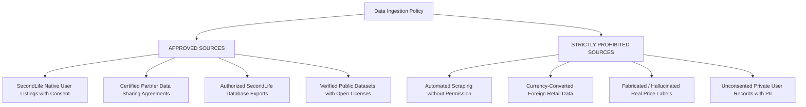

# Data Governance, Source Permissions, and Regulatory Compliance

**Project:** SecondLife AI Pricing  
**Document Version:** 1.0.0  
**Regulatory Jurisdiction:** Vietnam (Decree 13/2023/ND-CP on Personal Data Protection, Law on Intellectual Property)  
**Governance Scope:** Pre-owned Household Appliance Listing Ingestion & AI Model Training  

---

## 1. Core Data Governance Principles

The SecondLife AI Pricing system adheres to four non-negotiable data governance principles:

1. **Legality & Authorization First:** We ingest and train machine learning models strictly on datasets for which SecondLife holds verified, legally binding usage rights.
2. **Zero Unauthorized Web Scraping:** We explicitly prohibit automated scraping, crawling, or unauthorized harvesting of third-party platforms (including Chợ Tốt, Facebook Marketplace, and e-commerce websites).
3. **Strict Separation of Data Lineage & Provenance:** Every ingested listing record must trace back to a verifiable source, batch identifier, raw file SHA-256 checksum, and legal license tier.
4. **Target Label Independence:** Training target labels must represent authentic, unprompted seller asking prices or realized transaction prices, completely uninfluenced by model predictions to avoid self-reinforcing feedback loops.

---

## 2. Permitted vs. Prohibited Data Sources



### 2.1 Approved Data Sources (`license_status: authorized_partner` or `public_domain_cc0`)
1. **SecondLife Native User Listings:**
   - Pre-owned appliance listings submitted directly by registered users on the SecondLife web or mobile applications.
   - Users must accept the *SecondLife AI Data Contribution Terms* prior to publishing.
2. **Authorized SecondLife Refurbishment Partners:**
   - Inventories provided by commercial refurbishment businesses, repair workshops, and trade-in networks operating under a signed *B2B Data Sharing Agreement*.
3. **SecondLife Internal Transaction Records:**
   - Completed historical order records exported from SecondLife production storage with customer PII stripped.
4. **Verified Public Datasets:**
   - Academic or open-source datasets explicitly published under Creative Commons Zero (CC0), CC-BY-4.0, MIT, or Apache-2.0 licenses that permit commercial AI model training and include authentic Vietnamese used-product context.

### 2.2 Strictly Prohibited Data Sources (`license_status: unlicensed_blocked`)
1. **Unconsented Marketplace Scraping (Chợ Tốt, Facebook Marketplace, etc.):**
   - Violates platform Terms of Service.
   - Triggers legal liability under Vietnam's cybersecurity and personal data protection regulations.
   - Harvested data frequently contains ghost listings, broker spam, and inaccurate asking prices.
2. **Foreign Retail Proxy Conversion:**
   - Converting Brazilian retail BRL prices (from `TudoBonus/tudobonus`) or US Amazon USD prices to VND via foreign exchange rates is **strictly forbidden**. This practice fabricates false economic signals and corrupts model learning.
3. **Synthetic Data Masquerading as Real Market Data:**
   - Synthetic benchmark datasets may be used strictly for pipeline unit testing (`license_status: synthetic_test_only`), and must **never** be mixed into real model training or reported as real-world market accuracy.

---

## 3. Compliance with Vietnamese Data Privacy Laws (Decree 13/2023/ND-CP)

Vietnam's Personal Data Protection Decree (Decree 13/2023/ND-CP) imposes strict requirements on collecting, processing, and transferring personal data. To ensure full compliance:

### 3.1 Mandatory PII Stripping at Ingestion
The ingestion pipeline automatically screens and strips any personally identifiable information (PII) before storage in `data/processed/`:
- **Seller Contact Info:** Phone numbers, Zalo links, email addresses, and personal social media profiles are scrubbed from `description` and `title`.
- **Physical Locations:** Specific street addresses, apartment numbers, and house numbers are removed; only city-level or district-level metadata (e.g., `Quận 7, TP. Hồ Chí Minh`) is retained.
- **Financial Details:** Bank account numbers, payment credentials, and transaction receipts containing buyer/seller names are completely excluded.
- **Facial Redaction:** Photographs depicting people, domestic family members, or children in the background must be cropped or excluded.

---

## 4. Consent and User Terms Specification

### 4.1 Native SecondLife User Listing Consent Language
When a user lists an appliance on SecondLife, the listing form presents the following required consent disclosure:

> **[x] Điều khoản đóng góp dữ liệu định giá SecondLife AI:**  
> *"Tôi đồng ý cho phép SecondLife sử dụng thông tin và hình ảnh mô tả thiết bị gia dụng đã ẩn danh tính (không bao gồm họ tên, số điện thoại, địa chỉ cụ thể) nhằm mục đích nghiên cứu, huấn luyện mô hình trí tuệ nhân tạo (AI) để gợi ý giá niêm yết chính xác hơn cho cộng đồng đồ cũ tại Việt Nam."*

### 4.2 B2B Refurbishment Partner Data Agreement Schedule
Partner data agreements must incorporate Schedule A (Data Licensing and Usage Rights):
- **Grant of License:** Partner grants SecondLife a non-exclusive, perpetual, royalty-free license to use submitted inspection records, specifications, condition photos, and pricing history solely for developing AI estimation models.
- **Warranty of Ownership:** Partner warrants that it owns or has the right to distribute all uploaded photographs and inventory data.
- **Confidentiality:** Commercial pricing margins and proprietary supplier codes remain strictly confidential.

---

## 5. Technical Enforcement in the Codebase

Data governance policies are not merely administrative; they are strictly enforced through code:

1. **Schema-Level Enforcement (`src/data/pricing_schema.py`):**
   ```python
   @model_validator(mode="after")
   def validate_lifecycle_and_compliance(self) -> PricingListing:
       if not self._policy.allow_unlicensed and self.license_status == LicenseStatus.UNLICENSED_BLOCKED:
           raise ValueError(f"Listing {self.listing_id} has license_status='unlicensed_blocked' and cannot be used.")
       return self
   ```
2. **Automated Partitioning (`src/data/import_real_listings.py`):**
   - Any listing missing verified consent or tagged as `unlicensed_blocked` is immediately quarantined into `data/processed/v{version}/unauthorized.parquet`.
   - Quarantined records are physically separated and barred from the training pipeline.
3. **Cryptographic Provenance Audit (`ingestion_manifest.json`):**
   - Every ingestion batch logs the input file SHA-256 hash, record counts, and partition breakdown, creating an immutable audit trail.
