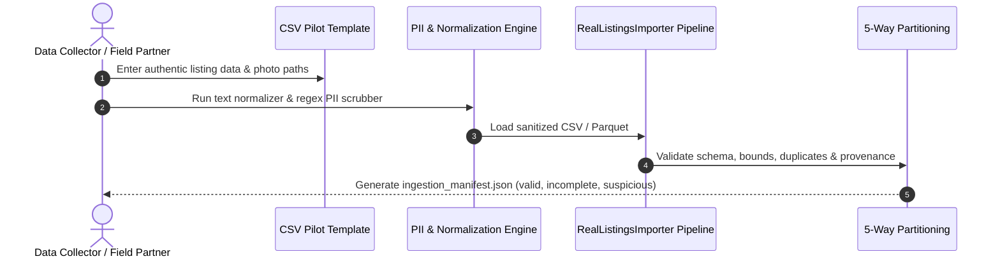

# Pilot Dataset Collection Guide: Authentic Vietnamese Used Appliance Listings

**Project:** SecondLife AI Pricing  
**Document Version:** 1.0.0  
**Target:** 10–30 Genuine Listings (Initial Batch) Expanding to 100–300 Listings (Full Pilot)  
**Author:** Senior Data Engineer, ML Engineer & Data Governance Specialist  

---

## 1. Objective & Governance Principles

This guide provides a standardized, operational procedure for collecting authentic Vietnamese pre-owned appliance listing records for the SecondLife AI Pricing models.

### Strict Governance Constraints:
1. **Zero Price Fabrication:** Asking prices must reflect authentic Vietnamese Dong (VND) valuations requested by actual sellers or certified refurbishment shops. Never interpolate or generate artificial prices.
2. **Zero Unauthorized Scraping:** No web scraping of Chợ Tốt, Facebook Marketplace, or other classified platforms without verified, written corporate authorization.
3. **Strict PII Redaction:** All seller names, phone numbers, home addresses, bank accounts, and personal contact handles must be scrubbed prior to dataset ingestion.
4. **Verifiable Permission Evidence:** Every record must reference a verifiable legal consent log (`USR-CONSENT-...`) or B2B data agreement (`B2B-REFURB-...`).
5. **Physical Unit Integrity:** Each pre-owned physical appliance must be assigned a unique `physical_item_id` to prevent conflating distinct physical units of the same catalog model.

---

## 2. Priority Categories & Target Specifications

The pilot prioritizes the three most prevalent secondary appliance classes in Vietnam:

| Priority Category | Vietnamese Term | Key Target Brands | Critical Specifications to Capture |
|:---|:---|:---|:---|
| **1. Washing Machine** | *Máy giặt* | Electrolux, Toshiba, LG, Panasonic, Aqua, Samsung | • Loading type: Top-load (*cửa trên*) vs. Front-load (*cửa trước*)<br>• Capacity: 7.0kg – 12.0kg<br>• Motor: Inverter vs. Non-inverter<br>• Physical condition: Tub rust, spin vibration, cosmetic scuffs |
| **2. Refrigerator** | *Tủ lạnh* | Panasonic, Toshiba, Sharp, Aqua, Samsung, Hitachi | • Capacity: 120L – 550L<br>• Type: Top-freezer (*ngăn đá trên*), Bottom-freezer, Side-by-side<br>• Technology: Inverter, no-frost (*không đóng tuyết*)<br>• Physical condition: Gasket seal integrity, shelf cracks, exterior dents |
| **3. Microwave Oven** | *Lò vi sóng* | Sharp, Electrolux, Panasonic, Toshiba, Bluestone | • Volume: 20L – 30L<br>• Control: Mechanical knobs (*nút vặn*) vs. Electronic digital keypad<br>• Function: Solo microwave vs. Grill-combo (*có nướng*)<br>• Physical condition: Turntable plate present, interior chamber rust, door latch |

---

## 3. Two Authorized Acquisition Channels

### Channel A: B2B Certified Refurbishment Partners (Fastest Path for First 10–30 Items)
- **Partners:** Reputable second-hand appliance stores in Ho Chi Minh City (e.g., Quận 8, Bình Thạnh) and Hanoi (e.g., Cầu Giấy, Hoàng Mai).
- **Agreement:** Execute SecondLife Partner Agreement Schedule B (Data Licensing for AI Research).
- **Data Provided:**
  - Actual in-store retail asking price (VND).
  - Physical inspection notes by technician.
  - Multi-angle photos taken on clean showroom floor.
- **Permission Evidence Tag:** e.g. `B2B-REFURB-HCMC-2026-001`.

### Channel B: SecondLife Native Beta Submissions (Dogfooding)
- **Mechanism:** SecondLife internal staff and beta community members submit their actual household appliances for AI appraisal.
- **Consent:** Explicit checkbox agreeing to Decree 13/2023/ND-CP data processing for model training.
- **Permission Evidence Tag:** e.g. `USR-CONSENT-DECREE13-2026-0089`.

---

## 4. Step-by-Step Practical Procedure



### Step 1: Photography Protocol (Multimodal Listings)
For each physical appliance unit, take 2–4 clear photos in good lighting:
1. **Front Exterior:** Whole unit with door closed.
2. **Interior Cavity:** Refrigerator shelves/drawers, washer drum, microwave turntable.
3. **Specification Rating Label:** Close-up of the manufacturer sticker showing model number, wattage/capacity, and manufacture year.
4. **Cosmetic Flaws (if any):** Scratches, dents, or discolored plastic.

Save images in: `data/raw/pilot_images/<physical_item_id>/photo_1.jpg`.

### Step 2: Fill the Pilot Template
Open [`data/templates/secondlife_pricing_template.csv`](file:///c:/Users/hieu.tuanz/Desktop/KY-9/SEP490/ai/secondlife-ai-pricing/data/templates/secondlife_pricing_template.csv) and input the 21 canonical fields:

```csv
listing_id,title,description,category,brand,model_number,condition,age_years,image_paths,listing_price_vnd,initial_listing_price_vnd,ai_suggested_price_vnd,user_adjusted_price_vnd,transaction_price_vnd,product_group_id,physical_item_id,listed_at,source,source_record_id,license_status,permission_evidence
PILOT-001,Tủ lạnh Panasonic Inverter 255 lít NR-BV280QSVN mới 95%,Tủ lạnh chạy êm làm lạnh nhanh nguyên zin khay kính chịu lực,Refrigerator,PANASONIC,NR-BV280QSVN,Excellent,1.5,"[""data/raw/pilot_images/PHYS-001/front.jpg""]",4500000,4500000,,,4300000,GRP-PHYS-001,PHYS-001,2026-10-15T09:00:00Z,secondlife_partner,STORE-ITEM-101,authorized_partner,B2B-REFURB-HCMC-2026-001
```

### Step 3: Automated PII Scrubbing
Before running ingestion, the pipeline's built-in `VietnameseTextNormalizer.scrub_pii()` will automatically:
- Replace phone numbers (`0912345678` -> `[SĐT_ẨN]`)
- Replace emails (`contact@seller.com` -> `[EMAIL_ẨN]`)
- Replace social handles (`zalo: 0987...` -> `zalo: [ẨN]`)

*Manual check:* Confirm that seller personal names and specific apartment numbers are excluded from the title and description.

### Step 4: Execute Pipeline Ingestion
Run the reproducible ingestion tool:
```bash
python -m src.data.import_real_listings --input data/raw/pilot_batch_01.csv --output-dir data/processed --version 1.0.0-pilot --verify-images
```

### Step 5: Review Manifest & Partition Breakdown
Inspect `data/processed/v1.0.0-pilot/ingestion_manifest.json`:
- `valid`: Records with verified images, schema conformance, and non-outlier prices.
- `incomplete`: Valid listings lacking images or model numbers (usable for text baselines).
- `suspicious`: Items flagged by category IQR price fences or duplicate detection.
- `unauthorized`: Any record missing valid license authorization (must be 0).
- `synthetic`: Any test fixture accidentally included (isolated from training).

---

## 5. Milestone Progression Checklist

### Phase 1: Seed Batch (10–30 Listings)
- [ ] 5–10 Washing machines (Electrolux, Toshiba, LG)
- [ ] 5–10 Refrigerators (Panasonic, Toshiba, Sharp)
- [ ] 5–10 Microwave ovens (Sharp, Electrolux)
- [ ] Verify 100% of photos accessible on disk
- [ ] Verify zero PII in descriptions
- [ ] Inspect initial price distribution boxplots

### Phase 2: Full Pilot (100–300 Listings)
- [ ] 40–100 Washing machines across diverse capacities (7kg, 8kg, 9kg, 10kg+)
- [ ] 40–100 Refrigerators across diverse volumes (150L, 250L, 350L, 500L+)
- [ ] 20–50 Microwave ovens (mechanical and digital)
- [ ] Minimum 3 distinct condition grades per category (`Like New`, `Good`, `Fair`)
- [ ] Execute `GroupShuffleSplit` verifying zero physical item leakage across train/val/test splits
- [ ] Compile `reports/real_dataset_readiness.md` and declare training data **READY**.
