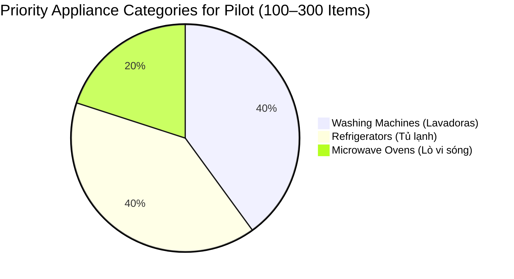
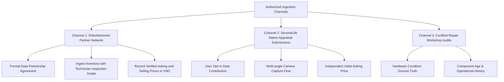

# Real Vietnamese Pricing Dataset Acquisition Plan

**Project:** SecondLife AI Pricing  
**Document Version:** 1.0.0  
**Target Market:** Vietnam (Ho Chi Minh City, Hanoi, Da Nang)  
**Currency:** Vietnamese Dong (VND)  
**Target Pilot Scale:** 100–300 Verified Authentic Listings  
**Primary Pilot Categories:** Washing Machines, Refrigerators, Microwave Ovens  

---

## 1. Overview and Problem Statement

Previous research (TASK 03) demonstrated that **no public, authorized dataset exists** that pairs authentic condition photographs of used appliances with Vietnamese descriptive text, condition tiers, and ground-truth listing prices in VND.

Converting foreign datasets (such as `TudoBonus/tudobonus` in Brazilian Real) or scraping external marketplaces (such as Chợ Tốt) without explicit consent violates platform Terms of Service, distorts price regression targets, and introduces serious legal liabilities under Vietnam's Personal Data Protection Decree (Decree 13/2023/ND-CP).

This document establishes a **legitimate, authorized, and reproducible data acquisition protocol** to collect a high-quality pilot dataset of **100–300 authentic listings** from certified partners and user submissions.

---

## 2. Priority Categories for the Initial Pilot

To maximize statistical significance and model learning efficiency with an initial 100–300 listings, data collection is focused on the three highest-volume second-hand household appliance categories in Vietnam:



1. **Washing Machines (`Washing Machine` - Máy giặt):**
   - High secondary market liquidity and demand in urban centers.
   - Distinct sub-types: Top-loading (cửa trên / lồng đứng) vs Front-loading (cửa ngang / lồng ngang).
   - High prevalence of inverter motor features and brand pricing premiums (Electrolux, LG, Toshiba, Panasonic).
2. **Refrigerators (`Refrigerator` - Tủ lạnh):**
   - Essential household appliance with measurable capacity metrics (150L - 600L).
   - Clear cosmetic depreciation indicators (external dents, gasket seal discoloration, interior shelf cracks).
   - Dominant brands: Panasonic, Toshiba, Sharp, Aqua, Samsung, Hitachi.
3. **Microwave Ovens (`Microwave` - Lò vi sóng):**
   - Compact countertop footprint with consistent photographic framing.
   - High price variance between mechanical dial models (cơ) and digital inverter models (điện tử có nướng).
   - Dominant brands: Sharp, Electrolux, Panasonic, Toshiba.

---

## 3. Legitimate Ingestion Channels

Data collection will strictly utilize authorized, consenting channels:



### Channel 1: Second-Hand Refurbishment Partner Network
- **Partners:** Certified second-hand electronics and appliance networks (e.g., Điện Máy Cũ, second-hand chain stores in HCMC and Hanoi).
- **Data Provided:** Audited inventory records with technician condition grading, multi-angle photos, original purchase invoice data (when available), initial asking price, and final realized transaction price.
- **Agreement:** Covered by the *SecondLife Data Sharing and Model Training Agreement* (see `docs/data_source_permissions.md`).

### Channel 2: SecondLife Native User Appraisal Submissions
- **Mechanism:** Users creating listings on the SecondLife web/mobile application upload photos and specify item details to receive pricing suggestions.
- **Independence of Target Label:** To prevent model feedback loops, the **initial asking price (`initial_listing_price_vnd`)** entered by the user *before* seeing any AI recommendation is stored as the primary target. Subsequent AI suggestions (`ai_suggested_price_vnd`), user adjustments (`user_adjusted_price_vnd`), and final sale prices (`transaction_price_vnd`) are logged separately.
- **Consent:** Explicit opt-in checkbox granting permission for anonymized listing data to be used in AI training.

---

## 4. Required Listing Data Attributes

Every listing collected in the pilot must conform to the canonical template (`data/templates/secondlife_pricing_template.csv`):

| Attribute | Status | Guidelines & Validation Rules |
|:---|:---:|:---|
| `listing_id` | **Required** | Unique identifier formatted as `SLVN-PILOT-XXXX`. |
| `title` | **Required** | Authentic Vietnamese title (min 5, max 255 chars). Must include brand or category. |
| `description` | Optional | Authentic Vietnamese description describing usage history, cosmetic flaws, and warranty. |
| `category` | **Required** | Must be one of: `Washing Machine`, `Refrigerator`, `Microwave`. |
| `brand` | **Required** | Manufacturer brand (e.g. `PANASONIC`, `TOSHIBA`, `ELECTROLUX`, `SHARP`, `LG`). |
| `model_number` | Highly Recommended | Manufacturer SKU code from rating label (e.g. `NR-BV280QSVN`). |
| `condition` | **Required** | Standard 5-tier grade: `Like New`, `Excellent`, `Good`, `Fair`, `Poor`. |
| `age_years` | Highly Recommended | Estimated age since purchase in years (0.0 to 15.0). |
| `image_paths` | **Required** | Minimum 1 (recommended 2-4) clear photographs in JPG/PNG format: <br>1. Front full view<br>2. Control panel / door interior<br>3. Manufacturer rating plate / model sticker<br>4. Defect or wear close-up (scratches, dents) |
| `listing_price_vnd` | **Required** | Unprompted seller asking price in VND (50,000 to 50,000,000 VND). |
| `initial_listing_price_vnd` | Optional | Asking price before AI recommendation. |
| `transaction_price_vnd` | Optional | Final sale price upon deal closure. |
| `product_group_id` | Highly Recommended | Appliance model/SKU cluster to guarantee zero data leakage across splits. |
| `listed_at` | **Required** | ISO 8601 timestamp of listing creation. |
| `source` | **Required** | `secondlife_partner` or `user_submission`. |
| `license_status` | **Required** | Must be `authorized_partner`. |

---

## 5. Ingestion Pipeline & Quality Assurance

Data collection will be executed using `src/data/import_real_listings.py`:

```bash
python src/data/import_real_listings.py \
    --input data/raw/pilot_listings.csv \
    --image-root data/pilot_images \
    --verify-images \
    --version 1.0.0
```

### Ingestion Partition Gates:
1. **Valid Partition (`data/processed/v1.0.0/valid.parquet`):**
   - Meets 100% of schema constraints.
   - Price falls within category IQR fences.
   - Referenced image files verified physically on disk.
   - Authorized license status confirmed.
2. **Incomplete Partition (`incomplete.parquet`):**
   - Valid text and price, but missing optional attributes (e.g. missing age or model number). Retained for text/tabular baseline experiments.
3. **Suspicious Partition (`suspicious.parquet`):**
   - Statistical price outliers (>1.5× IQR) or potential duplicate listings. Held for human expert review.
4. **Unauthorized Partition (`unauthorized.parquet`):**
   - Flagged if license status is unverified or scraped without authorization. **Quarantined and excluded from training.**

---

## 6. Pilot Execution Milestones

| Milestone | Target Date | Success Criteria |
|:---|:---:|:---|
| **M1: Template & Governance Sign-off** | 2026-10-15 | Ingestion pipeline, template CSV, and permission docs approved. |
| **M2: Partner Onboarding (HCMC & Hanoi)** | 2026-10-31 | 2 certified refurbishers onboarded with signed data agreements. |
| **M3: Initial Batch Ingestion (50 Listings)** | 2026-11-15 | First 50 multimodal listings ingested, validated, and partitioned. |
| **M4: Full Pilot Ingestion (100–300 Listings)** | 2026-11-30 | Full pilot completed with balanced distribution across the 3 priority categories. |
| **M5: Dataset Readiness Evaluation** | 2026-12-05 | Validation report confirms 0 leakage, valid prices, and transitions status from BLOCKED to READY. |
