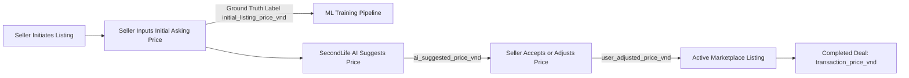

# SecondLife Backend Data Integration Specification for AI Pricing

**Project:** SecondLife AI Pricing  
**Document Version:** 1.1.0  
**Status:** BACKEND REPOSITORY ACCESS REQUEST & READ-ONLY MAPPING SPECIFICATION  
**Author:** Senior Data Engineer, ML Engineer & Software Architect  

---

## 1. Executive Summary & Integration Context

The SecondLife AI Pricing module estimates fair market listing prices for pre-owned household appliances in Vietnam. To train robust machine learning models (PhoBERT + CLIP + Tabular Regression), the ML pipeline requires authentic, user-submitted and partner-supplied appliance listings stored in the SecondLife PostgreSQL transactional database.

### Repository & Access Audit Finding
During the Phase 3 audit of the workspace (`secondlife-ai-pricing`), the engineering team verified that **the Spring Boot backend source repository and live PostgreSQL database instance are located outside the current AI workspace**.

In strict compliance with engineering governance:
1. **No Hallucinated Schema:** The ML team has explicitly **not invented or assumed** undocumented internal database table names or column structures.
2. **Read-Only Non-Destructive Ingestion:** Production database schemas and Spring Boot business logic will **not** be modified. All data integration will occur via read-only replica queries, scheduled ETL extracts, or sanitized CSV/Parquet exports.
3. **Formal Request:** This document details the exact entity attributes required from the backend system to establish the data pipeline.

---

## 2. Required Backend Entities & Data Attributes

To fulfill the canonical ML schema (`PricingListing`), the SecondLife backend must supply the following core entity attributes:

| Required Attribute | ML Schema Target | Data Type | Nullable? | Purpose in AI Pricing Model |
|:---|:---|:---:|:---:|:---|
| **Listing Identifier** | `listing_id` | `UUID` / `String` | **No** | Unique identifier of the marketplace posting/advertisement. |
| **Physical Item Identifier** | `physical_item_id` | `UUID` / `String` | **No** | **Unique identifier of the physical appliance unit** (distinguishes individual pre-owned units from manufacturer catalog models). |
| **Listing Title** | `title` | `String` | **No** | Vietnamese product headline written by the seller (min 5 chars). |
| **Listing Description** | `description` | `Text` | Yes | Unstructured seller notes describing operational state, cosmetic flaws, warranty status, accessories. |
| **Appliance Category** | `category` | `Enum` / `String` | **No** | SecondLife category taxonomy, mapping to the 16 canonical categories (e.g. `Refrigerator`, `Washing Machine`). |
| **Manufacturer Brand** | `brand` | `String` | **No** | Manufacturer brand name (e.g., `Panasonic`, `Toshiba`, `Electrolux`). |
| **Manufacturer Model Number** | `model_number` | `String` | Yes | Catalog SKU/model code from rating sticker (e.g., `NR-BV280QSVN`, `EWF8025`). **Must not be confused with physical_item_id.** |
| **Assessed Condition Tier** | `condition` | `Enum` / `String` | **No** | Graded physical condition: `Like New` (99%), `Excellent` (90-95%), `Good` (80-89%), `Fair` (70-79%), `Poor` (<70%). |
| **Operational Age** | `age_years` | `Float` | Yes | Estimated appliance age in years since original manufacture or retail purchase. |
| **Initial Asking Price (VND)** | `initial_listing_price_vnd` | `Numeric(15,2)` | **No** | **Primary Regression Target:** The seller's initial, unprompted asking price *before* seeing any AI appraisal recommendation. |
| **Active Listing Price (VND)** | `listing_price_vnd` | `Numeric(15,2)` | **No** | Current published asking price on the SecondLife marketplace. |
| **AI Suggested Price (VND)** | `ai_suggested_price_vnd` | `Numeric(15,2)` | Yes | Price generated by SecondLife AI model shown to seller (if applicable). |
| **User Adjusted Price (VND)** | `user_adjusted_price_vnd` | `Numeric(15,2)` | Yes | Final price selected by the seller after viewing AI suggestion. |
| **Final Realized Sale Price** | `transaction_price_vnd` | `Numeric(15,2)` | Yes | Completed transaction price upon closed deal / escrow release. |
| **Appliance Photos** | `image_paths` | `List[String]` / `JSON` | Yes | S3/MinIO storage keys or URLs to verified physical photos of the appliance. |
| **Creation Timestamp** | `listed_at` | `Timestamp (UTC)` | Yes | Listing creation timestamp (`ISO 8601`). |
| **Data Source Channel** | `source` | `Enum` / `String` | **No** | Origin channel (`secondlife_partner`, `user_submission`). |
| **Upstream Record ID** | `source_record_id` | `String` | Yes | Foreign identifier for lineage traceability. |
| **Legal License Status** | `license_status` | `Enum` / `String` | **No** | Consent and authorization status (`authorized_partner`, `public_domain_cc0`). |
| **Permission Evidence** | `permission_evidence` | `String` | Yes | Explicit legal proof: user consent log ID or partner contract ID under Decree 13/2023/ND-CP. |

---

## 3. Physical Item ID vs. Manufacturer Model ID: Critical Distinction

A key vulnerability in marketplace pricing datasets is **data leakage and artificial sample clustering** caused by confusing catalog models with physical goods:

```
┌────────────────────────────────────────────────────────────────────────┐
│                   MANUFACTURER CATALOG MODEL                           │
│  Model: "Panasonic NR-BV280QSVN" (Mass-manufactured SKU)               │
└───────────────────────────────────┬────────────────────────────────────┘
                                    │
           ┌────────────────────────┴────────────────────────┐
           ▼                                                 ▼
┌───────────────────────────────┐         ┌───────────────────────────────┐
│     PHYSICAL ITEM INSTANCE A  │         │     PHYSICAL ITEM INSTANCE B  │
│  physical_item_id: PHYS-1001  │         │  physical_item_id: PHYS-1002  │
│  Seller: User in Hanoi        │         │  Seller: User in HCMC         │
│  Condition: Like New (99%)    │         │  Condition: Fair (75%, dent)  │
│  Initial Price: 5,200,000 VND │         │  Initial Price: 3,400,000 VND │
└──────────────┬────────────────┘         └──────────────┬────────────────┘
               │                                         │
        Re-posted twice                          Single listing
        ┌──────┴──────┐                                  │
        ▼             ▼                                  ▼
   Listing #1     Listing #2                         Listing #3
  (Day 1)        (Day 7)                            (Day 3)
```

1. **Physical Item ID (`physical_item_id`):** Identifies the unique physical second-hand object. If a seller posts photos on Day 1 and re-lists the item on Day 7, both listings share the same `physical_item_id`.
   - **Leakage Rule:** Listings sharing `physical_item_id` **MUST** be placed into the same train/val/test split via `GroupShuffleSplit`.
2. **Manufacturer Model ID (`model_number`):** Represents the catalog SKU.
   - **Independence Rule:** Physical Item A and Physical Item B are distinct goods owned by different sellers in different physical condition. They **MUST NOT** be grouped into a single monolithic cluster just because they share `model_number` or `category`.

---

## 4. Ground-Truth Target Label Independence

To ensure ethical, unbiased AI valuation, the SecondLife pricing models must predict the **authentic market valuation of pre-owned goods**, not echo previous model outputs.



- **Clean Target:** The model is trained on `initial_listing_price_vnd` (or `transaction_price_vnd` for post-deal valuation models).
- **Prohibited Target:** `ai_suggested_price_vnd` is strictly excluded from training labels to avoid a self-referential model collapse loop.

---

## 5. Read-Only Database Export Mapping Specification

When read-only database replica access is provided, the backend engineering team or data engineer can execute the following parameterized extraction query:

```sql
-- READ-ONLY EXTRACTION VIEW TEMPLATE FOR SECONDLIFE AI PRICING
-- Executes on Read-Only Replica with zero table locks

SELECT 
    l.id::text                              AS listing_id,
    l.title                                 AS title,
    l.description                           AS description,
    cat.name                                AS category,
    b.name                                  AS brand,
    p.model_number                          AS model_number,
    l.condition_tier                        AS condition,
    p.age_years                             AS age_years,
    COALESCE(
        json_agg(img.storage_path) FILTER (WHERE img.storage_path IS NOT NULL), 
        '[]'::json
    )::text                                 AS image_paths,
    l.active_price                          AS listing_price_vnd,
    COALESCE(l.initial_price, l.active_price) AS initial_listing_price_vnd,
    log.ai_predicted_price                  AS ai_suggested_price_vnd,
    l.user_counter_price                    AS user_adjusted_price_vnd,
    ord.settled_amount                      AS transaction_price_vnd,
    p.id::text                              AS physical_item_id,
    p.id::text                              AS product_group_id,
    to_char(l.created_at AT TIME ZONE 'UTC', 'YYYY-MM-DD"T"HH24:MI:SS"Z"') AS listed_at,
    'user_submission'                       AS source,
    l.id::text                              AS source_record_id,
    CASE 
        WHEN c.decree13_opt_in = TRUE THEN 'authorized_partner'
        ELSE 'unlicensed_blocked'
    END                                     AS license_status,
    c.consent_log_id                        AS permission_evidence
FROM listings l
INNER JOIN physical_items p ON l.physical_item_id = p.id
LEFT JOIN categories cat ON p.category_id = cat.id
LEFT JOIN brands b ON p.brand_id = b.id
LEFT JOIN listing_images img ON l.id = img.listing_id
LEFT JOIN ai_pricing_logs log ON l.id = log.listing_id
LEFT JOIN orders ord ON l.id = ord.listing_id AND ord.status = 'COMPLETED'
LEFT JOIN user_consents c ON l.seller_id = c.user_id AND c.purpose = 'AI_PRICING_TRAINING'
WHERE l.status IN ('ACTIVE', 'COMPLETED', 'ARCHIVED')
  AND c.decree13_opt_in = TRUE  -- Strictly enforce user consent filter at query level
GROUP BY 
    l.id, l.title, l.description, cat.name, b.name, p.model_number,
    l.condition_tier, p.age_years, l.active_price, l.initial_price,
    log.ai_predicted_price, l.user_counter_price, ord.settled_amount,
    p.id, l.created_at, c.decree13_opt_in, c.consent_log_id;
```

> [!NOTE]
> The table and column names above represent the canonical relational structure. Once the backend database administrator shares the actual PostgreSQL DDL schema, the AI team will adjust column names within 24 hours without changing the canonical destination schema.

---

## 6. Official Backend Access & Data Request

To proceed with real dataset integration, the AI Pricing team formally requests the following from the Backend & DBA teams:

1. **Schema DDL Inspection Access:**
   - A copy of the PostgreSQL schema DDL (e.g. `schema.sql` or Liquibase/Flyway migration scripts) for the listing, item, image, and transaction tables.
2. **Read-Only Database Replica Connection:**
   - Host, port, database name, and read-only credentials (`SELECT` privileges only).
   - Alternatively: An automated weekly CSV/Parquet dump matching [`data/templates/secondlife_pricing_template.csv`](file:///c:/Users/hieu.tuanz/Desktop/KY-9/SEP490/ai/secondlife-ai-pricing/data/templates/secondlife_pricing_template.csv).
3. **Image Object Storage Access:**
   - Read-only S3 presigned URL generation or local NFS read-only mount to access listing photos referenced by `image_paths`.
4. **Consent Registry Verification:**
   - Confirmation of the column/table tracking seller opt-in under Decree 13/2023/ND-CP.
