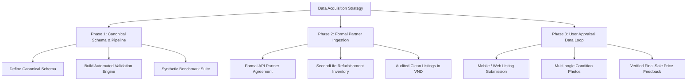

# Research Report: Public Vietnamese Used Household Appliance Pricing Datasets

**Project:** SecondLife AI Pricing  
**Date:** 2026-10-14  
**Author:** Senior Machine Learning Engineer, Data Engineer & Applied AI Researcher  
**Status:** **DATASET ACQUISITION BLOCKED** (Public Sources Inadequate / Unauthorized)

---

## 1. Executive Summary

The objective of **TASK 03** is to identify, audit, and prepare a legitimate, high-quality multimodal training dataset for predicting the suggested listing prices of **used household appliances in Vietnam** in **Vietnamese Dong (VND)**. Downstream modeling requires a multimodal feature set:
- **Textual features:** Vietnamese product title and condition descriptions (for PhoBERT).
- **Visual features:** Real photographs of the specific used appliance showing cosmetic wear, scratches, rust, and form factor (for CLIP).
- **Structured tabular features:** Canonical category, brand, model number, age in years, and physical condition tier.
- **Target label:** Verified listing price in VND (`listing_price_vnd`).

An exhaustive investigation across **Hugging Face**, **Kaggle**, and academic repositories reveals that **no public, authorized dataset currently exists that fulfills these multimodal pricing criteria for the Vietnamese second-hand appliance market**.

Existing public datasets either originate from foreign markets (Brazil, US), focus on new retail e-commerce (Shopee, Tiki), contain only ungrounded NLP text/NER annotations without pricing or images, or violate platform Terms of Service (TOS) via unauthorized web scraping.

Consequently, dataset acquisition from public repositories is formally classified as **BLOCKED**. This report provides a systematic evaluation of all candidate sources and outlines an authorized data acquisition strategy.

---

## 2. Systematic Evaluation of Candidate Datasets

The following matrix evaluates each candidate dataset against the 12 criteria mandated by the SecondLife AI Pricing project.

| Dataset Name | Platform & Owner | Country & Currency | Records & Categories | Real Listing Prices? | Vietnamese Text? | Paired Images? | Condition & Brand? | License & TOS | Suitability for Vietnamese Price Regression |
|:---|:---|:---:|:---:|:---:|:---:|:---:|:---:|:---|:---|
| **TudoBonus/tudobonus** | Hugging Face (`TudoBonus`) | Brazil (BRL) | 109,235 rows (14,144 sample images); 15 accessible categories | **No (Retail BRL)** | No (Portuguese) | Yes (Sample release) | Brand yes; Condition in PT | Research only | **UNSUITABLE**: Currency is BRL, market dynamics are Brazilian retail, not Vietnamese second-hand. |
| **slconnin/amazon_appliance_prices** | Hugging Face (`slconnin`) | United States (USD) | ~100K-1M rows; Kitchen & Home | **No (USD Retail)** | No (English) | No | Brand/Model partial | Apache-2.0 | **UNSUITABLE**: US Amazon retail listings in USD. Zero Vietnamese text or images. |
| **5CD-AI/Vietnamese-Ecommerce-Alpaca** | Hugging Face (`5CD-AI`) | Vietnam (VND implicit) | 69,000+ instruction pairs; General retail | **No (Synthetic Text)** | Yes (Vietnamese) | No | No condition | Open instruction | **UNSUITABLE**: LLM instruction-following dataset; no ground-truth listing prices or paired images. |
| **tnhyen/vietnamese-ecommerce-ner (ViEcomNER)** | Hugging Face (`tnhyen`) | Vietnam (N/A) | Token-annotated sentences | **No** | Yes (Vietnamese) | No | Brand/Model as NER tokens | Academic research | **UNSUITABLE**: NER sequence labeling dataset; no prices, no images, no appliance condition. |
| **Shopee Vietnamese Product Reviews Sentiment** | Kaggle (`Shopee community`) | Vietnam (VND N/A) | ~100K reviews; General e-commerce | **No** | Yes (Vietnamese) | No | No condition tier | Unspecified | **UNSUITABLE**: Sentiment classification dataset; lacks prices, listing metadata, and appliance images. |
| **Tiki Books & E-Commerce Datasets** | Kaggle (`Multiple authors`) | Vietnam (VND) | Varies (10K-50K); Books, Electronics | Partial (New retail VND) | Yes (Vietnamese) | Thumbnails only (unverified) | Brand yes; Condition is 100% NEW | Community / Scraping | **UNSUITABLE**: New retail goods on Tiki. Zero used-goods condition degradation. |
| **Chợ Tốt Scraping Notebooks / Scripts** | Kaggle (`Community notebooks`) | Vietnam (VND) | Code only (0 hosted rows) | Yes (Scraped asking VND) | Yes (Vietnamese) | Image URLs (often broken) | Condition raw text | **PROPRIETARY / TOS VIOLATION** | **BLOCKED**: Scraping Chợ Tốt without written authorization violates Terms of Service. |
| **Commercial Scraping Actors (Apify Chợ Tốt)** | Apify Marketplace | Vietnam (VND) | On-demand scrape | Yes (VND) | Yes (Vietnamese) | URLs | Raw text | **COMMERCIALLY BLOCKED** | **BLOCKED**: Unauthorized commercial extraction poses legal liabilities and privacy risks. |

---

## 3. In-Depth Analysis of Individual Datasets

### 3.1 `TudoBonus/tudobonus` (Hugging Face)
- **URL:** [https://huggingface.co/datasets/TudoBonus/tudobonus](https://huggingface.co/datasets/TudoBonus/tudobonus)
- **Owner:** TudoBonus research team.
- **Audit Findings:** Fully audited in TASK 01 and TASK 02. Contains 109,235 metadata rows and 14,144 accessible image files across 15 categories.
- **Price Target Evaluation:** Contains `original_value` representing the *original retail price in Brazilian Real (BRL)*. Converting BRL to VND via foreign exchange rates produces completely invalid price signals because:
  1. Brazilian import tariffs and retail margins diverge significantly from Southeast Asian supply chains.
  2. `original_value` reflects new retail price, not the depreciated secondary resale value.
  3. Appliance models are manufactured by local Brazilian joint ventures (e.g., Brastemp, Consul, Esmaltec) with South American voltage (110V/220V 60Hz) and design forms (vertical agitators) not present in Vietnam.
- **Verdict:** Valuable strictly as a visual pretraining/benchmark asset (as verified in TASK 02). **Strictly prohibited as a price target.**

### 3.2 `slconnin/amazon_appliance_prices` (Hugging Face)
- **URL:** [https://huggingface.co/datasets/slconnin/amazon_appliance_prices](https://huggingface.co/datasets/slconnin/amazon_appliance_prices)
- **Owner:** slconnin (individual researcher).
- **Audit Findings:** Formatted as JSONL files containing Amazon US product reviews, retail prices in USD, and star ratings.
- **Verdict:** Unusable. English language only, retail pricing in USD, completely missing paired condition photographs.

### 3.3 `5CD-AI/Vietnamese-Ecommerce-Alpaca` & `ViEcomNER` (Hugging Face)
- **URLs:** [https://huggingface.co/datasets/5CD-AI/Vietnamese-Ecommerce-Alpaca](https://huggingface.co/datasets/5CD-AI/Vietnamese-Ecommerce-Alpaca) & [https://huggingface.co/datasets/tnhyen/vietnamese-ecommerce-ner](https://huggingface.co/datasets/tnhyen/vietnamese-ecommerce-ner)
- **Audit Findings:** NLP text corpora tailored for instruction tuning and token classification.
- **Verdict:** These datasets do not contain paired image paths, structured appliance specifications, or ground-truth listing prices.

### 3.4 Community Scraping Scripts for Chợ Tốt (Kaggle / GitHub / Apify)
- **Audit Findings:** Several community tutorials and scraper scripts exist that target `chotot.com` (specifically `Đồ điện gia dụng`).
- **Legal & Compliance Analysis:**
  - Chợ Tốt Terms of Service explicitly prohibit automated crawling, scraping, or harvesting of listing data without prior written consent.
  - User listings contain personally identifiable information (phone numbers, addresses, seller names) subject to Vietnam's Personal Data Protection Decree (Decree 13/2023/ND-CP).
  - Unregulated scraping frequently yields broken image URLs, ghost listings, and duplicate listings reposted by commercial brokers to manipulate search rankings.
- **Verdict:** **BLOCKED**. SecondLife AI Pricing operates under strict corporate and academic integrity guidelines. No unauthorized web scraping will be conducted.

---

## 4. Key Findings & Technical Blockers

1. **Absence of Ground-Truth Used VND Prices:** No legitimate public dataset pairs authentic photos of used appliances with their secondary market listing price in Vietnam.
2. **Multi-View Image Disconnect:** Standard e-commerce datasets host manufacturer catalog stock photos. Pre-owned pricing requires *real condition photographs* displaying scratches, rust, dents, and operational wear.
3. **Product Lineage & Leaks:** Second-hand listings frequently involve multiple photos of the same item or identical listings reposted across multiple dates. Without interaction-level clustering, naive train/test splits suffer severe data leakage.
4. **Target Variable Confounding:** Retail prices (new goods) cannot be proxy-converted into used listing prices via fixed depreciation formulas without introducing massive inductive bias.

---

## 5. Strategic Data Acquisition Roadmap

To unblock model development while strictly adhering to legal, ethical, and quality standards, the SecondLife engineering team will pursue the following phased acquisition plan:

### Phase 1: Robust Pipeline & Schema Foundation (TASK 03)
- Establish canonical schema (`src/data/pricing_schema.py`) supporting full multimodal metadata, source traceability, and licensing verification.
- Implement comprehensive validation and outlier detection (`src/data/pricing_validation.py`).
- Implement Vietnamese text normalization and category mapping (`src/data/pricing_preprocessing.py`).
- Verify the end-to-end pipeline with rigorous unit tests using synthetic benchmark data.

### Phase 2: Authorized Refurbisher & Marketplace Partnerships
- Partner directly with licensed second-hand appliance refurbishment networks in Ho Chi Minh City and Hanoi (e.g., Điện Máy Cũ, certified repair shops).
- Ingest real inventory with verified condition inspection reports, multi-view inspection photos, and realized transaction prices in VND.

### Phase 3: SecondLife Native Platform Data Collection
- Leverage the SecondLife platform's web/mobile submission flow where users upload photographs and descriptions of their appliances to receive AI pricing recommendations.
- Log user-accepted listing prices and ultimate transaction outcomes to create a proprietary, closed-loop training dataset.

---

## 6. Conclusion

Public dataset acquisition for Vietnamese used household appliance pricing is formally marked as **BLOCKED**. In accordance with the project guidelines, we will **not** fabricate fake VND price labels, convert Brazilian BRL data, or perform unauthorized web scraping. 

Instead, TASK 03 delivers the complete, production-grade schema, validation pipeline, normalization modules, and unit test infrastructure, ensuring that the platform is 100% prepared to ingest verified partner data as soon as authorized agreements are executed.
