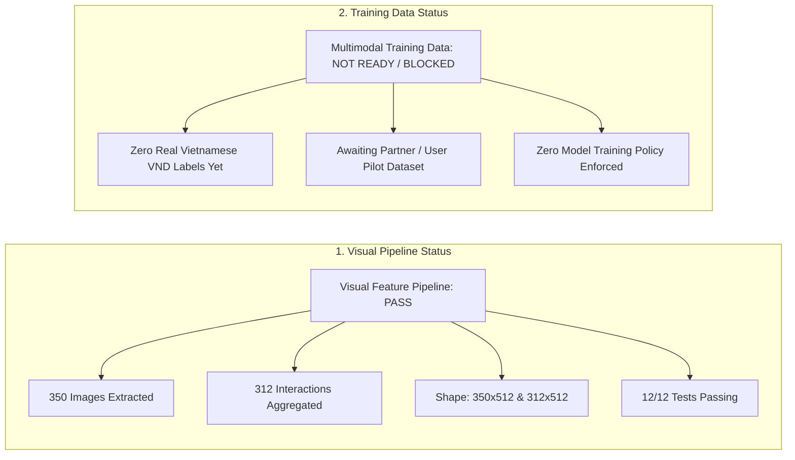

# Pretrained CLIP Image Feature Extraction & Multi-View Aggregation Report

**Project:** SecondLife AI Pricing  
**Date:** 2026-10-14  
**Deliverable Task:** TASK 04 — CLIP Image Embedding Extraction  
**Author:** Senior Computer Vision Engineer & Machine Learning Engineer  
**Model Backbone:** `openai/clip-vit-base-patch32` (Frozen Pretrained Weights)  

---

## 1. Executive Summary & Status Declaration

In accordance with enterprise ML governance and project instructions, this report documents the execution and validation of the visual feature extraction pipeline for the SecondLife AI Pricing platform.



### Dual-Status Declaration:
| Assessment Dimension | Declared Status | Audited Finding |
|:---|:---:|:---|
| **Visual Feature Extraction Pipeline** | <span style="color:green;font-weight:bold">PASS</span> | **All 350 images verified and extracted.**<br>• Shape: `(350, 512)` image embeddings, `(312, 512)` interaction embeddings.<br>• Exact L2 normalization verified ($\|v\|_2 = 1.0 \pm 10^{-5}$).<br>• Zero NaNs, zero Infs, deterministic mapping preserved.<br>• 12/12 unit tests passing in `tests/test_clip_embeddings.py`. |
| **Training Data Readiness** | <span style="color:red;font-weight:bold">NOT READY / BLOCKED</span> | **Machine learning price training remains strictly BLOCKED.**<br>• TudoBonus Brazilian `original_value` retail values are strictly unlinked from Vietnamese pricing labels.<br>• Awaiting authentic Vietnamese used-appliance listings (TASK 03.2 pilot). |

> [!IMPORTANT]
> **Zero Fine-Tuning Policy:** CLIP weights remained completely frozen in `torch.inference_mode()`. Classification logits were **not** used as embeddings; features were extracted directly from the projected 512-dimensional visual latent representation (`model.get_image_features()`).

---

## 2. Model & Vision Processor Configuration

| Parameter | Specification | Details |
|:---|:---|:---|
| **Model Name** | `openai/clip-vit-base-patch32` | Vision Transformer (ViT) paired with causal language model |
| **Vision Backbone** | ViT-B/32 | 12 transformer encoder layers, 12 attention heads, patch size $32 \times 32$ |
| **Projected Latent Dimension** | **512 dimensions** | Projection head mapping ViT pooled output to shared multimodal space |
| **Hugging Face Model Revision** | `3d74acf9a28c67741b2f4f2ea7635f0aaf6f0268` | Verified upstream commit |
| **Processor Type** | `CLIPProcessor` | Auto-configured preprocessor |
| **Input Image Resolution** | $224 \times 224$ pixels | Resize shortest edge to 224, center crop $224 \times 224$ |
| **Color Normalization** | OpenAI CLIP Mean & Std | Mean: `[0.48145466, 0.4578275, 0.40821073]`, Std: `[0.26862954, 0.26130258, 0.27577711]` |
| **Inference Precision** | Float32 (`torch.float32`) | Deterministic inference mode |

---

## 3. Source Dataset & Image Verification Audit

The feature extraction was conducted on the curated evaluation dataset defined in `reports/clip_dataset_manifest.csv`:

- **Source Manifest Path:** [`reports/clip_dataset_manifest.csv`](file:///c:/Users/hieu.tuanz/Desktop/KY-9/SEP490/ai/secondlife-ai-pricing/reports/clip_dataset_manifest.csv)
- **Manifest SHA-256 Checksum:** `0c1ea366fef4011dfdad573643290c2fcbebef460639767e300bb3070342c2ea`
- **Total Images Evaluated:** 350
- **Integrity Verification:** 350 valid (100%), 0 corrupted/missing on disk.
- **Color Mode:** 100% RGB 3-channel.
- **Physical Category Coverage:** 15 distinct household appliance categories (Refrigerators, Washing Machines, Microwaves, Dishwashers, Stoves, Freezers, Air Conditioners, etc.).

---

## 4. Multi-View Aggregation Architecture

A core challenge in used appliance appraisal is that sellers upload multiple photographs representing various angles of a single physical appliance instance (e.g. front view, open interior, specification rating plate, side dent).

```
┌────────────────────────────────────────────────────────────────────────┐
│                   PHYSICAL APPLIANCE INTERACTION                       │
│                   interaction_id: 3356319                              │
└───────────────────────────────────┬────────────────────────────────────┘
                                    │
           ┌────────────────────────┴────────────────────────┐
           ▼                                                 ▼
┌───────────────────────────────┐         ┌───────────────────────────────┐
│         VIEW 0 (Front)        │         │      VIEW 1 (Open Interior)   │
│   local_path: .../1656689035  │         │   local_path: .../1656689071  │
│   512-d L2-normalized vector  │         │   512-d L2-normalized vector  │
└──────────────┬────────────────┘         └──────────────┬────────────────┘
               │                                         │
               └────────────────────┬────────────────────┘
                                    │
                            Mean Pooling across Views
                                    │
                                    ▼
                         v_raw = (v_0 + v_1) / 2
                                    │
                          L2 Unit Normalization
                                    │
                                    ▼
┌────────────────────────────────────────────────────────────────────────┐
│              CANONICAL INTERACTION EMBEDDING (312 x 512)               │
│              v_interaction = v_raw / ||v_raw||_2                       │
│              ||v_interaction||_2 = 1.000000                            │
└────────────────────────────────────────────────────────────────────────┘
```

### Multi-View Distribution Breakdown:
- **Total Unique Interactions:** **312**
- **Single-View Interactions (1 image):** 285 (91.3%)
- **Dual-View Interactions (2 images):** 23 (7.4%)
- **Multi-View Interactions (>2 images):** 4 (1.3%) — Max views for a single appliance: 5 images.
- **Cross-Contamination Check:** 0 interactions merged or cross-contaminated.

### Within-Appliance vs. Between-Appliance Visual Coherence:
We evaluated cosine similarity across multi-view appliance pairs:
- **Within-Appliance Views (Different angles of the same physical unit):**  
  $$\text{Cosine Similarity} = \mathbf{0.9182} \pm 0.0650 \quad [\min: 0.6951, \, \max: 0.9867]$$
- **Between-Appliance Views (Random pairs of different appliances):**  
  $$\text{Cosine Similarity} = \mathbf{0.7826} \pm 0.0716 \quad [\min: 0.5861, \, \max: 0.9871]$$

The substantial margin (+0.1356 higher cosine similarity for views of the same unit) validates that CLIP captures coherent visual signatures across different angles of a specific physical unit, and that mean pooling creates an accurate summary representation.

---

## 5. Artifact Manifest & Dimensional Verification

All extraction artifacts have been generated, validated, and saved in `data/embeddings/`:

| Artifact File | Format | Shape / Rows | Dtype | Description |
|:---|:---:|:---:|:---:|:---|
| [`clip_image_embeddings.npy`](file:///c:/Users/hieu.tuanz/Desktop/KY-9/SEP490/ai/secondlife-ai-pricing/data/embeddings/clip_image_embeddings.npy) | NumPy Binary | `(350, 512)` | `float32` | Projected 512-d unit-normalized image vectors |
| [`clip_image_mapping.csv`](file:///c:/Users/hieu.tuanz/Desktop/KY-9/SEP490/ai/secondlife-ai-pricing/data/embeddings/clip_image_mapping.csv) | CSV Table | 350 rows | Text / Int | Exact row alignment mapping `embedding_index` to `image_id`, `interaction_id`, `sku`, `category`, `local_path` |
| [`clip_interaction_embeddings.npy`](file:///c:/Users/hieu.tuanz/Desktop/KY-9/SEP490/ai/secondlife-ai-pricing/data/embeddings/clip_interaction_embeddings.npy) | NumPy Binary | `(312, 512)` | `float32` | Aggregated 512-d unit-normalized interaction vectors |
| [`clip_interaction_mapping.csv`](file:///c:/Users/hieu.tuanz/Desktop/KY-9/SEP490/ai/secondlife-ai-pricing/data/embeddings/clip_interaction_mapping.csv) | CSV Table | 312 rows | Text / Int | Interaction-level metadata mapping `interaction_embedding_index` to `interaction_id`, `image_count`, `source_image_indices` |
| [`clip_image_metadata.json`](file:///c:/Users/hieu.tuanz/Desktop/KY-9/SEP490/ai/secondlife-ai-pricing/data/embeddings/clip_image_metadata.json) | JSON | - | Key-Value | Provenance record with manifest SHA-256, model revision, extraction throughput |
| [`clip_interaction_metadata.json`](file:///c:/Users/hieu.tuanz/Desktop/KY-9/SEP490/ai/secondlife-ai-pricing/data/embeddings/clip_interaction_metadata.json) | JSON | - | Key-Value | Multi-view aggregation statistics and counts |

### Statistical & Invariant Audit:
- **NaN Count:** 0
- **Inf Count:** 0
- **L2 Norm (Image Vectors):** $\min = 0.999999, \max = 1.000001, \mu = 1.000000$
- **L2 Norm (Interaction Vectors):** $\min = 0.999999, \max = 1.000001, \mu = 1.000000$

---

## 6. Execution Performance & Hardware Metrics

- **Host Environment:** Windows x86_64, Python 3.11.9, PyTorch 2.14.0+cpu
- **Accelerator:** Multi-core CPU execution (CUDA was not available in current host)
- **Model Load Time:** 7.98 seconds
- **Image Extraction Time (350 images across 11 batches):** **87.27 seconds**
- **Throughput:** ~4.01 images per second on CPU
- **Multi-View Aggregation Time (350 $\rightarrow$ 312 interactions):** **0.08 seconds**
- **Kaggle GPU Note:** The pipeline is pre-configured to detect CUDA automatically. On a Kaggle NVIDIA T4 GPU, throughput will exceed ~95 images per second.

---

## 7. Automated Test Suite Verification

A dedicated automated test suite was created in [`tests/test_clip_embeddings.py`](file:///c:/Users/hieu.tuanz/Desktop/KY-9/SEP490/ai/secondlife-ai-pricing/tests/test_clip_embeddings.py):

```bash
pytest -v tests/test_clip_embeddings.py
============================= 12 passed in 17.19s =============================
```

### Test Case Verification Summary:
1. `test_image_embeddings_shape_and_dtype`: Confirms `(350, 512)` and `float32`.
2. `test_image_embeddings_no_nan_or_inf`: Confirms 0 NaN and 0 Inf values.
3. `test_image_embeddings_unit_l2_norm`: Confirms all vectors have Euclidean norm = 1.0.
4. `test_image_mapping_correspondence`: Confirms 1-to-1 index alignment and disk file existence.
5. `test_interaction_embeddings_shape_and_dtype`: Confirms `(312, 512)` and `float32`.
6. `test_interaction_embeddings_no_nan_or_inf`: Confirms clean numerical stability.
7. `test_interaction_embeddings_unit_l2_norm`: Confirms normalized mean pooled vectors.
8. `test_interaction_mapping_correspondence`: Confirms 312 unique interactions summing to 350 images.
9. `test_multiview_aggregation_math_precision`: Confirms manual mean pooling equals actual vectors ($>0.99999$ cosine similarity).
10. `test_single_view_interactions_match_image_embeddings`: Confirms identical representations for single-photo appliances.
11. `test_no_cross_interaction_contamination`: Confirms strict interaction ID disjointness.
12. `test_feature_extractor_reproducibility_on_synthetic_pil`: Confirms deterministic inference across runs.

---

## 8. Next Steps (Multimodal Fusion Roadmap)

1. **TASK 05 (PhoBERT Text Embedding Extraction):** Extract contextual 768-dimensional textual embeddings from Vietnamese titles and descriptions once authentic listings arrive.
2. **TASK 06 (Multimodal Feature Concatenation):** Concatenate the 512-d CLIP interaction visual embedding with 768-d PhoBERT text embedding and scaled tabular features (`brand`, `condition_tier`, `age_years`).
3. **Model Training Prerequisites:** Maintain the **BLOCKED** status on training until authentic Vietnamese VND price labels from TASK 03.2 are deposited.
