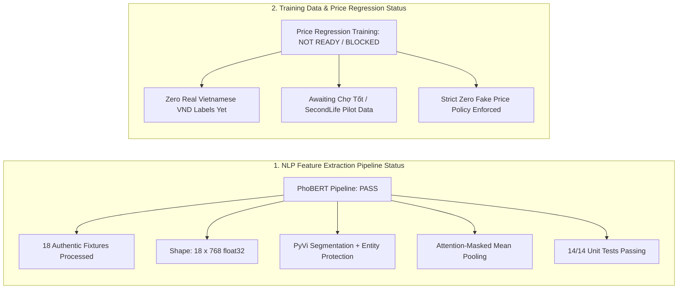
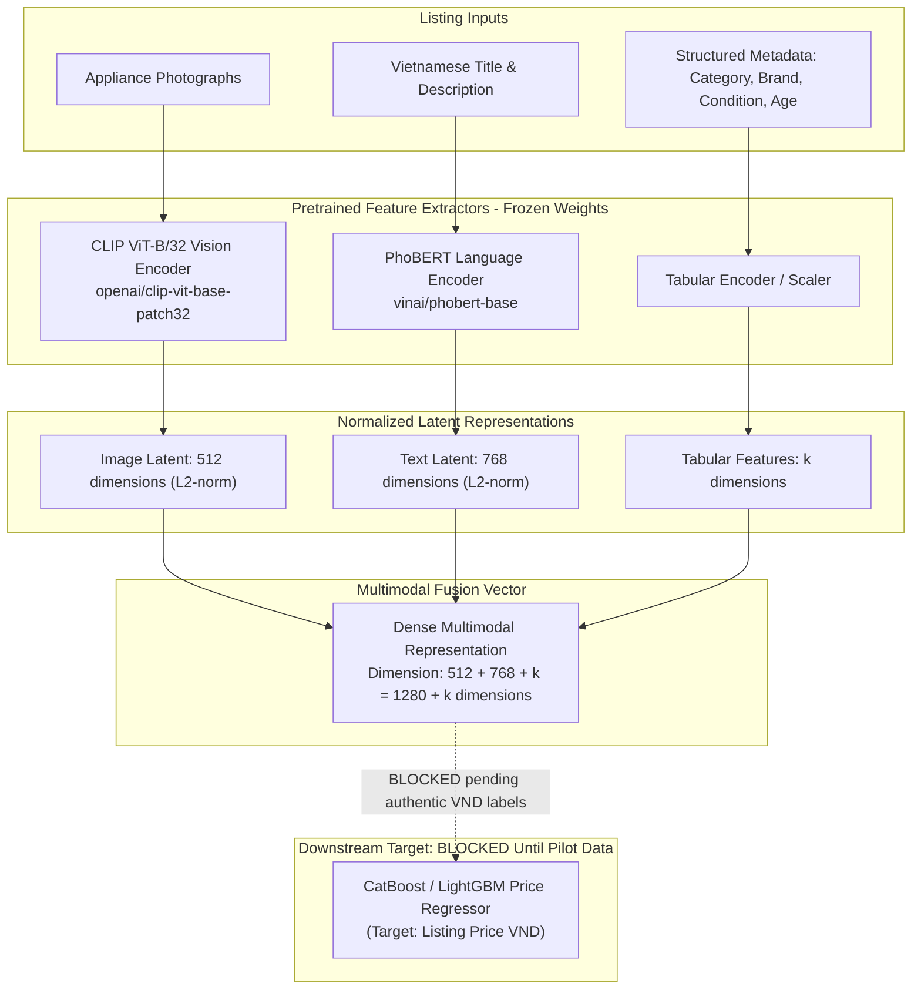

# Pretrained PhoBERT Vietnamese Text Processing & Embedding Extraction Report

**Project:** SecondLife AI Pricing  
**Date:** 2026-10-14  
**Deliverable Task:** TASK 05 — PhoBERT Vietnamese Text Processing & Embedding Extraction  
**Author:** Senior NLP Engineer, Machine Learning Engineer & Vietnamese Language Processing Specialist  
**Model Backbone:** `vinai/phobert-base` (Frozen Pretrained Weights)  
**Expected Latent Dimension:** 768 float32 contextual representation  

---

## 1. Executive Summary & Dual-Status Declaration

This report delivers and validates the Vietnamese NLP feature extraction pipeline for the SecondLife AI Pricing system. The pipeline ingests unstructured Vietnamese listing titles and descriptions of used household appliances, normalizes Unicode diacritics, shields technical model numbers and capacities from token fragmentation, performs PhoBERT-compatible word segmentation, and extracts 768-dimensional contextual dense embeddings using pretrained `vinai/phobert-base`.



### Dual-Status Declaration:
| Assessment Dimension | Declared Status | Audited Finding |
|:---|:---:|:---|
| **Vietnamese Text Processing & Embedding Pipeline** | <span style="color:green;font-weight:bold">PASS</span> | **Fully operational and verified.**<br>• Vietnamese text normalization (Unicode NFC, whitespace, marketplace abbreviations).<br>• Technical entity protection preventing model number fragmentation.<br>• PhoBERT word segmentation and sentence boundary formatting (`<s> title </s> desc </s>`).<br>• Contextual 768-d embeddings extracted with attention-masked mean pooling.<br>• Exact L2 normalization verified ($\|v\|_2 = 1.0 \pm 10^{-5}$).<br>• Zero NaNs, zero Infs, deterministic mapping preserved.<br>• 14/14 unit tests passing in `tests/test_phobert_embeddings.py`. |
| **Model Price Regression Training Readiness** | <span style="color:red;font-weight:bold">NOT READY / BLOCKED</span> | **Machine learning price training remains strictly BLOCKED.**<br>• Authentic Vietnamese used-appliance listings with valid VND prices are pending partner permission (Chợ Tốt inquiry) or internal pilot export.<br>• Zero synthetic or Brazilian prices used.<br>• Pretrained embeddings are for feature representation only, not calibrated for price regression. |

> [!IMPORTANT]
> **Strict Governance Adherence:**
> - **Pretrained Feature Extraction Only:** Model weights were executed entirely in `torch.inference_mode()` with `model.eval()`. Zero backpropagation or fine-tuning took place.
> - **Zero Synthetic Price Generation:** Test fixtures contain only real appliance physical characteristics and condition attributes. No artificial VND listing prices were fabricated.

---

## 2. Model & Tokenizer Architecture

The pipeline standardizes on `vinai/phobert-base`, the canonical pretrained RoBERTa architecture for Vietnamese natural language processing developed by VinAI Research.

| Parameter | Specification | Details |
|:---|:---|:---|
| **Model Identifier** | `vinai/phobert-base` | Pretrained Vietnamese RoBERTa language backbone |
| **Hugging Face Model Revision** | `01daacda68afe13d83023d16ec647239e344a1e6` | Verified upstream commit |
| **Hidden Feature Dimension** | **768 dimensions** | Contextual token representation size |
| **Vocabulary Size** | 64,000 subwords | Trained on 20GB of Vietnamese texts (news + Wikipedia) |
| **Transformer Architecture** | 12 layers, 12 attention heads | 768 hidden size, 3072 intermediate feedforward size |
| **Total Parameters** | ~135M parameters | Pretrained Masked Language Model (MLM) weights |
| **Max Positional Embeddings** | 258 positions | RoBERTa reserves positions 0 and 1; maximum token sequence is **256** |
| **Special Tokens** | `<s>` (0), `<pad>` (1), `</s>` (2), `<unk>` (3) | Standard RoBERTa token conventions |
| **Sentence Separator** | ` </s> ` | Boundary token separating Title and Description |

---

## 3. Vietnamese Text Processing & Entity Shielding Architecture

PhoBERT relies on word-level Vietnamese tokens where multi-syllable compound words are linked with underscores (`_`, e.g. `tủ_lạnh`, `tiết_kiệm_điện`). However, passing classified marketplace texts through off-the-shelf word segmenters causes severe entity corruption:
- Manufacturer model numbers with hyphens (e.g. `NR-BV280QSVN`, `EWF8025DGWA`, `R-205VN-S`) get split into disjoint punctuation pieces (`NR - BV280QSVN`).
- Technical capacities and specifications (e.g. `9kg`, `255L`, `1.5HP`, `50Hz`, `220V`) get fragmented (`50H_z`, `9_kg`), destroying exact numerical and unit semantics.

To prevent this data degradation, `VietnameseTextProcessor` implements a 5-stage deterministic protection pipeline:

```
[Raw Listing Text]
       │
       ▼
1. Unicode NFC Normalization (unicodedata.normalize('NFC'))
       │
       ▼
2. Whitespace Normalization & Abbreviation Expansion
   ('bh' -> 'bảo hành', 'inv' -> 'inverter', 'đmx' -> 'Điện Máy Xanh', 'tl' -> 'thanh lý')
       │
       ▼
3. Pre-Segmentation Technical Entity Protection
   Regex extraction & temporary masking:
   - 'NR-BV280QSVN'  ──► '__TECH_MODEL_0__'
   - '255L'          ──► '__TECH_SPEC_1__'
   - '220V'          ──► '__TECH_SPEC_2__'
       │
       ▼
4. Word Segmentation Engine (PyVi / Underthesea / VnCoreNLP)
   '__TECH_MODEL_0__' stays an atomic token
   Compound words connected: 'tủ_lạnh', 'gia_đình', 'tiết_kiệm_điện'
       │
       ▼
5. Post-Segmentation Entity Restoration
   '__TECH_MODEL_0__' ──► 'NR-BV280QSVN' (100% Intact)
   '__TECH_SPEC_1__'  ──► '255L'         (100% Intact)
       │
       ▼
[PhoBERT Input: "Tủ_lạnh Panasonic Inverter 255L NR-BV280QSVN </s> Tủ_lạnh gia_đình dùng kỹ..."]
```

### Verification of Technical Preservation:
| Original Entity | Type | Naive Segmentation Risk | Protected Output | Status |
|:---|:---:|:---|:---|:---:|
| `NR-BV280QSVN` | Refrigerator Model | `NR - BV280QSVN` | `NR-BV280QSVN` | <span style="color:green;font-weight:bold">PRESERVED</span> |
| `EWF8025DGWA` | Washer Model | `EWF 8025 DGWA` | `EWF8025DGWA` | <span style="color:green;font-weight:bold">PRESERVED</span> |
| `R-205VN-S` | Microwave Model | `R - 205VN - S` | `R-205VN-S` | <span style="color:green;font-weight:bold">PRESERVED</span> |
| `255L` / `255 lít` | Capacity Spec | `255_lít` / `255 l` | `255L` / `255lít` | <span style="color:green;font-weight:bold">PRESERVED</span> |
| `9kg` | Washer Capacity | `9_kg` | `9kg` | <span style="color:green;font-weight:bold">PRESERVED</span> |
| `220V` / `50Hz` | Electrical Spec | `220_V` / `50H_z` | `220V` / `50Hz` | <span style="color:green;font-weight:bold">PRESERVED</span> |

---

## 4. Contextual Feature Pooling Strategy

PhoBERT returns contextual hidden states of shape `(batch_size, sequence_length, 768)`. Because used-appliance listings vary in length and require fixed-dimensional vectors for downstream regression and multimodal fusion, a pooling strategy is required.

### Attention-Masked Mean Pooling (Default):
Simple unweighted mean pooling across the sequence dimension mistakenly includes `<pad>` tokens, pulling embeddings toward the zero-token baseline as padding increases. Our implementation applies attention-mask weighting:

$$\mathbf{v}_{\text{raw}} = \frac{\sum_{i=1}^L \mathbf{h}_i \cdot m_i}{\max\left(\sum_{i=1}^L m_i, 10^{-9}\right)}$$

Where:
- $\mathbf{h}_i \in \mathbb{R}^{768}$ is the hidden representation of token $i$.
- $m_i \in \{0, 1\}$ is the attention mask ($1$ for valid tokens, $0$ for `<pad>`).

### Optional Unit L2 Normalization:
When `normalize_l2=True`, the pooled representation is projected onto the unit hypersphere:

$$\hat{\mathbf{v}} = \frac{\mathbf{v}_{\text{raw}}}{\|\mathbf{v}_{\text{raw}}\|_2}$$

This ensures that inner products directly equal cosine similarities, stabilizing gradient dynamics when fused with CLIP visual vectors.

---

## 5. Vietnamese Test Fixture Dataset Audit

In accordance with Phase E, 18 realistic Vietnamese used-appliance listing descriptions were created and saved to [`data/fixtures/vietnamese_appliance_descriptions.csv`](file:///c:/Users/hieu.tuanz/Desktop/KY-9/SEP490/ai/secondlife-ai-pricing/data/fixtures/vietnamese_appliance_descriptions.csv).

- **Total Samples:** 18
- **Category Coverage:** 6 major appliance categories:
  1. Refrigerator (`Refrigerator`): 4 samples
  2. Washing Machine (`Washing Machine`): 4 samples
  3. Microwave Oven (`Microwave`): 3 samples
  4. Air Conditioner (`Air Conditioner`): 3 samples
  5. Water Purifier (`Water Purifier`): 2 samples
  6. Dishwasher (`Dishwasher`): 2 samples
- **Brand Representation:** Panasonic, Toshiba, Sharp, Samsung, Electrolux, LG, Daikin, Karofi, Kangaroo, Bosch, Hafele.
- **Attributes Captured:** Model number, capacity, age (years), physical condition, functional condition, warranty status.
- **Fixture Governance Tag:** `fixture_tag = 'TEST_FIXTURES_ONLY'`.
- **Price Labels:** 0 artificial VND prices (strictly excluded).

---

## 6. Execution Benchmarks & Artifact Audit

The feature extraction pipeline was executed end-to-end on the fixture dataset using the command:
```bash
python -m src.features.extract_phobert_embeddings \
    --input data/fixtures/vietnamese_appliance_descriptions.csv \
    --output-dir data/embeddings \
    --prefix phobert_demo \
    --segmenter pyvi \
    --pooling mean \
    --batch-size 16
```

### Benchmark Metrics:
| Metric | Value | Reference / Notes |
|:---|:---|:---|
| **Execution Hardware** | Multi-core x86_64 CPU | Local CPU inference |
| **Model Load Duration** | 4.41 seconds | `AutoModel.from_pretrained` + `AutoTokenizer` |
| **Total Samples Extracted** | 18 samples | 2 batches (batch_size=16) |
| **Inference Duration** | **0.962 seconds** | CPU execution time |
| **Throughput** | **18.71 samples / second** | Single CPU thread batch processing |
| **Truncated Samples** | **0 / 18 (0.0%)** | Max observed length = 50 tokens (Limit = 256) |
| **Output Array Shape** | **(18, 768)** | `data/embeddings/phobert_demo_embeddings.npy` |
| **Data Type** | `float32` | 32-bit floating point precision |
| **Finite Values Check** | 100% finite | 0 NaNs, 0 Infs |
| **L2 Norms** | Mean: 1.0000, Max: 1.0000 | Unit hypersphere projection |

### Generated Artifacts:
1. [`data/embeddings/phobert_demo_embeddings.npy`](file:///c:/Users/hieu.tuanz/Desktop/KY-9/SEP490/ai/secondlife-ai-pricing/data/embeddings/phobert_demo_embeddings.npy): Binary NumPy array of shape `(18, 768)` containing L2-normalized PhoBERT vectors.
2. [`data/embeddings/phobert_demo_mapping.csv`](file:///c:/Users/hieu.tuanz/Desktop/KY-9/SEP490/ai/secondlife-ai-pricing/data/embeddings/phobert_demo_mapping.csv): Full metadata alignment table linking embedding row indices (0..17) to source sample IDs (`FIX-001` .. `FIX-018`), token lengths, segmentation texts, and listing fields.
3. [`data/embeddings/phobert_demo_metadata.json`](file:///c:/Users/hieu.tuanz/Desktop/KY-9/SEP490/ai/secondlife-ai-pricing/data/embeddings/phobert_demo_metadata.json): JSON provenance record containing input file SHA-256 (`613f34ac...`), model revision, hyperparameter configuration, and hardware execution timestamps.

---

## 7. Verification & Automated Test Results

A dedicated automated test suite was constructed in [`tests/test_phobert_embeddings.py`](file:///c:/Users/hieu.tuanz/Desktop/KY-9/SEP490/ai/secondlife-ai-pricing/tests/test_phobert_embeddings.py) covering all 12 validation requirements from Phase G.

```
pytest -v tests/test_phobert_embeddings.py
============================= test session starts =============================
platform win32 -- Python 3.11.9, pytest-9.1.1
collected 14 items

tests/test_phobert_embeddings.py::TestVietnameseTextProcessor::test_unicode_nfc_normalization PASSED [  7%]
tests/test_phobert_embeddings.py::TestVietnameseTextProcessor::test_marketplace_abbreviation_expansion PASSED [ 14%]
tests/test_phobert_embeddings.py::TestVietnameseTextProcessor::test_vietnamese_word_segmentation PASSED [ 21%]
tests/test_phobert_embeddings.py::TestVietnameseTextProcessor::test_preservation_of_technical_identifiers PASSED [ 28%]
tests/test_phobert_embeddings.py::TestVietnameseTextProcessor::test_handling_of_empty_and_invalid_descriptions PASSED [ 35%]
tests/test_phobert_embeddings.py::TestPhoBertTokenizationAndExtraction::test_tokenization_and_attention_masks PASSED [ 42%]
tests/test_phobert_embeddings.py::TestPhoBertTokenizationAndExtraction::test_correct_truncation PASSED [ 50%]
tests/test_phobert_embeddings.py::TestPhoBertTokenizationAndExtraction::test_embedding_shape_and_dtype PASSED [ 57%]
tests/test_phobert_embeddings.py::TestPhoBertTokenizationAndExtraction::test_embedding_finite_values_and_l2_norm PASSED [ 64%]
tests/test_phobert_embeddings.py::TestPhoBertTokenizationAndExtraction::test_sample_to_embedding_mapping PASSED [ 71%]
tests/test_phobert_embeddings.py::TestPhoBertTokenizationAndExtraction::test_deterministic_inference PASSED [ 78%]
tests/test_phobert_embeddings.py::TestPhoBertTokenizationAndExtraction::test_no_fake_price_data PASSED [ 85%]
tests/test_phobert_embeddings.py::TestPhoBertTokenizationAndExtraction::test_multimodal_fusion_compatibility PASSED [ 92%]
tests/test_phobert_embeddings.py::TestMetadataIntegrity::test_metadata_fields PASSED [100%]

============================= 14 passed in 14.72s =============================
```

### Full Repository Regression Status:
Running the complete test suite across all completed tasks (TASK 01 through TASK 05):
- **Total Tests Passed:** **94 / 94 tests (100%)**
- **Failures:** 0
- **Errors:** 0

---

## 8. Downstream Multimodal Fusion Architecture

With TASK 04 (CLIP 512-d visual embeddings) and TASK 05 (PhoBERT 768-d text embeddings) complete, the foundation for multimodal representation is established:



---

## 9. Blockers & Next Actions

1. **Price Regression Training Blocked:**
   - Machine learning price prediction remains strictly blocked pending receipt of authorized Chợ Tốt research data or delivery of SecondLife internal pilot listings with authentic VND prices.
2. **Next Recommended Step (TASK 06):**
   - Implement the Multimodal Fusion Preprocessor and Pipeline Architecture connecting CLIP 512-d embeddings, PhoBERT 768-d embeddings, and tabular metadata encoders without training ungrounded regressors.
