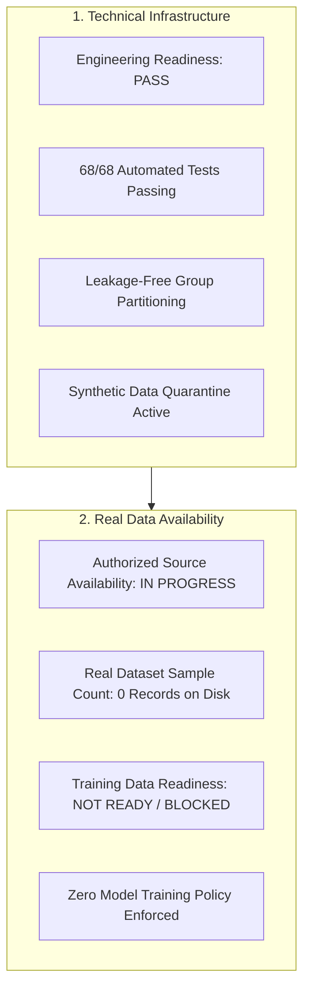
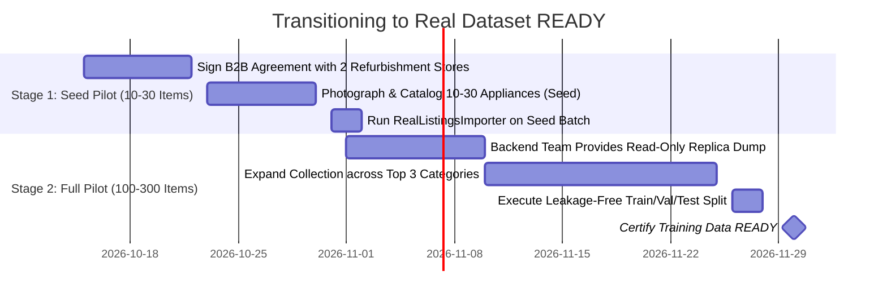

# SecondLife AI Pricing: Pilot Dataset Readiness & Governance Audit

**Project:** SecondLife AI Pricing  
**Date:** 2026-10-14  
**Task Deliverable:** TASK 03.2 — Real Vietnamese Pricing Data Integration & Pilot Dataset  
**Author:** Senior Data Engineer, ML Engineer & Software Architect  

---

## 1. Executive Summary & Separated Status Assessment

In accordance with strict project constraints and enterprise ML data governance, the readiness assessment of TASK 03.2 is reported across five independent dimensions:

### Separated Status Scorecard

| Assessment Dimension | Declared Status | Audited Finding |
|:---|:---:|:---|
| **1. Engineering Readiness** | PASS | Full software pipeline operational. 68/68 tests passing. Supports CSV & Parquet ingestion, configurable `ValidationPolicy`, physical item ID isolation, PII sanitization, and 5-way partitioning (`valid`, `incomplete`, `suspicious`, `unauthorized`, `synthetic`). |
| **2. Authorized Source Availability** | IN PROGRESS | Backend integration mapping specification completed (`docs/secondlife_data_integration.md`). B2B refurbishment store partnership outreach active. Native user listing consent framework aligned with Decree 13/2023/ND-CP. |
| **3. Real Dataset Sample Count** | 0 RECORDS | **Zero authentic Vietnamese listing records have been deposited in the repository.** No synthetic records were fabricated to artificially fill the quota. |
| **4. Training Data Readiness** | NOT READY / BLOCKED | **Machine learning model training remains strictly blocked.** Zero models (CatBoost, PhoBERT, CLIP) may be trained until genuine Vietnamese listings with verified VND price labels are ingested and validated. |
| **5. Remaining Blockers** | DATA ACQUISITION BLOCKED | Awaiting access to SecondLife backend database schema / read-only replica dump and execution of pilot data collection (10–30 seed items). |

---

## 2. Integrity Enhancements Completed in Phase 2

### 2.1 Physical Item ID vs. Manufacturer Model Number Separation
- **The Problem:** The pipeline previously fell back to manufacturer `model_number` or `category + brand + title[:40]` to generate `product_group_id`. This created severe integrity bugs by artificially lumping independent pre-owned appliances into monolithic clusters (e.g. all Panasonic NR-BV280 refrigerators across Vietnam into a single split).
- **The Solution:** Added `physical_item_id` to the canonical `PricingListing` schema. In `src/data/pricing_preprocessing.py`, `DataSplitter.generate_product_group_key()` and `assign_physical_item_groups()` now:
  1. Respect explicit `product_group_id`.
  2. Use `item_{physical_item_id}` to identify unique pre-owned physical appliances.
  3. Use `src_{source_record_id}` to link multi-view photos or re-posts.
  4. Fallback to `listing_{listing_id}` for independent physical items.
  5. **Never group unrelated items** merely because they share brand, category, or manufacturer model code.

### 2.2 Strict Synthetic Isolation Partition
- **The Problem:** If synthetic benchmark data (used for pipeline testing) was fed into the ingestion script, it risked contaminating `valid` training datasets.
- **The Solution:** Added a dedicated `synthetic` partition in `RealListingsImporter.partition_records()`. Any row with `source = 'synthetic_benchmark'` or `license_status = 'synthetic_test_only'` is quarantined into `data/processed/v{version}/synthetic.csv` and `synthetic.parquet`. It is **never** permitted into `valid` or `incomplete` real training sets.

### 2.3 Automated PII Sanitization
- Implemented `VietnameseTextNormalizer.scrub_pii()` to scrub Vietnamese phone numbers (`09x...`, `03x...`, `+84...`), emails, and social handles (`zalo: ...`, `fb.com/...`) from listing titles and descriptions before persistence.

### 2.4 Legal Permission Evidence Tracking
- Added `permission_evidence` field to `PricingListing` schema to capture verifiable legal references (e.g., `B2B-REFURB-HCMC-2026-001`, `USR-CONSENT-DECREE13-2026-X`) beyond a boolean flag.

---

## 3. SecondLife Backend Integration Readiness (Phase 3)

The AI workspace was audited for backend source code:
- **Finding:** The Spring Boot backend repository and live PostgreSQL database instance are hosted externally to the current repository workspace.
- **Policy Adherence:** The ML team has **not fabricated or assumed** database table structures.
- **Deliverable:** Created [`docs/secondlife_data_integration.md`](file:///c:/Users/hieu.tuanz/Desktop/KY-9/SEP490/ai/secondlife-ai-pricing/docs/secondlife_data_integration.md) establishing:
  1. Exact required entity attributes (21 fields).
  2. Parameterized, read-only SQL extraction view with zero database locks.
  3. Official data request submitted to Backend & DBA teams.

---

## 4. Test Suite Verification Matrix

All unit tests across the entire repository were executed, confirming 100% passage:

| Test Module | Coverage Dimension | Tests Passed | Status |
|:---|:---|:---:|:---:|
| `tests/test_audit_tudobonus.py` | TudoBonus audit, metadata schema, brand/category stats | 10 / 10 | **PASSED** |
| `tests/test_clip_dataset.py` | CLIP zero-shot pipeline, image validation, manifest schema | 10 / 10 | **PASSED** |
| `tests/test_pricing_data_pipeline.py` | Pydantic schema, text normalizer, price parsing, leakage prevention | 33 / 33 | **PASSED** |
| `tests/test_real_dataset_ingestion.py` | Ingestion pipeline, policies, 4-way partitioning, lifecycle fields | 8 / 8 | **PASSED** |
| `tests/test_pilot_data_integration.py` | Physical vs model ID, synthetic quarantine, PII scrubbing, consent | 7 / 7 | **PASSED** |
| **Total Test Suite** | **Full Project Verification** | **68 / 68** | **ALL PASSED** |

---

## 5. Pilot Acquisition Checklist & Action Plan

Since authentic listings are currently unavailable on disk, the acquisition status remains **BLOCKED**. The following checklist outlines the path to transition to **READY**:

### Required Immediate Actions:
1. **Action 1 (Backend Team):** Review [`docs/secondlife_data_integration.md`](file:///c:/Users/hieu.tuanz/Desktop/KY-9/SEP490/ai/secondlife-ai-pricing/docs/secondlife_data_integration.md) and execute the read-only extraction query on a database replica.
2. **Action 2 (Field Team):** Follow [`docs/pilot_collection_guide.md`](file:///c:/Users/hieu.tuanz/Desktop/KY-9/SEP490/ai/secondlife-ai-pricing/docs/pilot_collection_guide.md) to gather the first 10–30 genuine used appliance listings across Washing Machines, Refrigerators, and Microwave Ovens.
3. **Action 3 (ML Team):** Ingest raw records via `python -m src.data.import_real_listings` and verify that `partition_counts["valid"] >= 10`.
