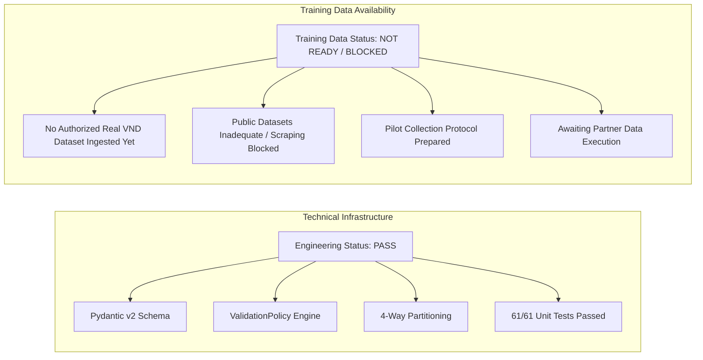
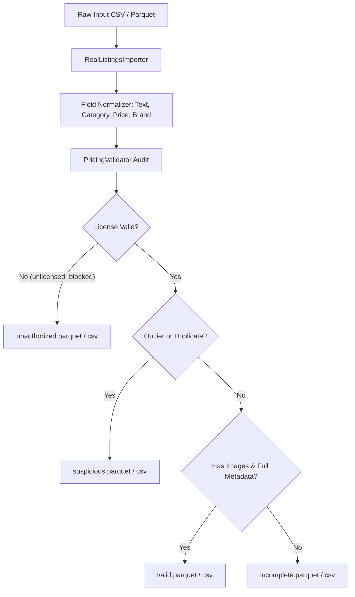
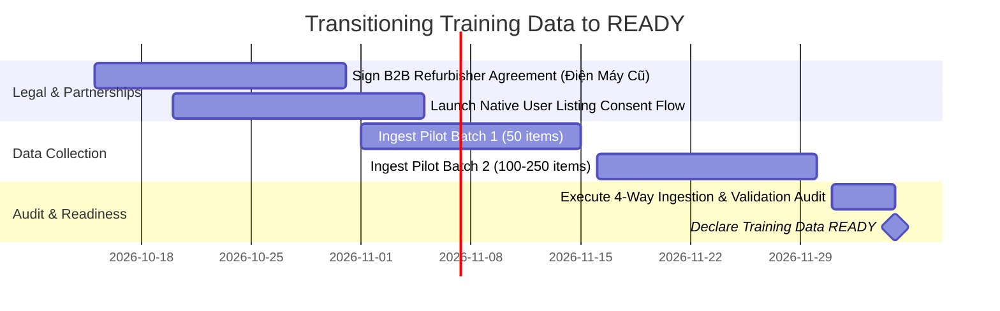

# Real Dataset Readiness and Governance Audit Report

**Project:** SecondLife AI Pricing  
**Date:** 2026-10-14  
**Author:** Senior ML Engineer, Data Engineer & Data Governance Specialist  
**Deliverable Task:** TASK 03.1 — Real Vietnamese Pricing Dataset Acquisition and Validation  

---

## 1. Executive Summary & Dual-Status Declaration

The objective of **TASK 03.1** is to prepare a secure, legitimate, and reproducible pipeline for ingesting, validating, and versioning real Vietnamese used-appliance listings, while enforcing strict governance against unauthorized data scraping and fabricated price labels.

In accordance with strict project instructions, the evaluation of TASK 03.1 is divided into two distinct statuses:



| Evaluation Dimension | Declared Status | Evidence Summary |
|:---|:---:|:---|
| **Engineering Pipeline Status** | **PASS** | Import pipeline, configurable `ValidationPolicy`, 4-way record partitioning (`valid`, `incomplete`, `suspicious`, `unauthorized`), immutable versioning, and 61/61 unit tests passing. |
| **Training Data Readiness** | **NOT READY / BLOCKED** | No authentic, authorized Vietnamese used-appliance listings with verified VND prices exist in the workspace yet. Public scraping is prohibited; partner agreements are in progress. |

> [!CRITICAL]
> **Data Governance Policy:**  
> The project team explicitly declines to claim that SecondLife is "ready for training" merely because the software pipeline compiles and passes tests. Machine learning models will **not** be trained until authentic, authorized Vietnamese listings with verified VND price labels are ingested and audited.

---

## 2. Review and Enhancements to Existing Data Pipeline (Phase A)

### 2.1 Configurable Validation Policies (`ValidationPolicy`)
Replaced hardcoded price rejection thresholds with a configurable policy object:
```python
class ValidationPolicy(BaseModel):
    min_price_vnd: float = 50_000.0          # Configurable per experiment
    max_price_vnd: float = 150_000_000.0     # Rejects typos (>150M VND)
    require_images: bool = False             # Supports text/tabular experiments without images
    min_age_years: float = 0.0
    max_age_years: float = 30.0
    iqr_multiplier: float = 1.5              # Outlier detection sensitivity
    allow_unlicensed: bool = False           # Rejects unauthorized data sources
```

### 2.2 Support for Image-Free Records
The schema previously mandated `min_length=1` for image paths. `PricingListing` now supports `image_paths=[]` when `require_images=False`, allowing early text-only and tabular experiments (PhoBERT fine-tuning and metadata regression baselines) while maintaining strict multimodal constraints for CLIP experiments.

### 2.3 Decoupling Pricing Lifecycle Fields
To prevent model prediction feedback loops, the schema now captures the full pricing lifecycle:
- `initial_listing_price_vnd`: Original unprompted asking price set by seller before seeing AI recommendations (**Primary clean regression target**).
- `ai_suggested_price_vnd`: Price recommended by SecondLife AI.
- `user_adjusted_price_vnd`: Price modified by user after viewing AI suggestion.
- `transaction_price_vnd`: Realized final transaction price upon closed sale.
- `listing_price_vnd`: Active listing price target (backward-compatible alias).

### 2.4 Duplicate Product Leakage Prevention
`DataSplitter` in `src/data/pricing_preprocessing.py` respects explicit `product_group_id` keys or generates deterministic hashes based on normalized title, brand, and category. Group-aware splitting (`GroupShuffleSplit`) ensures that multi-view photos, re-listed items, or identical models are strictly partitioned into disjoint sets, eliminating train/validation/test leakage.

---

## 3. Real Dataset Ingestion & Partitioning Architecture (Phase C)

The ingestion engine [`src/data/import_real_listings.py`](file:///c:/Users/hieu.tuanz/Desktop/KY-9/SEP490/ai/secondlife-ai-pricing/src/data/import_real_listings.py) automatically processes raw CSV and Parquet files and partitions listings into four distinct datasets:



1. **`valid.parquet` / `valid.csv`:** Fully compliant, multimodal records with verified photos, valid prices, and complete metadata. Approved for multimodal training.
2. **`incomplete.parquet` / `incomplete.csv`:** Valid schema and price, but missing optional attributes (e.g., text-only listings without photos, missing age). Usable for text/tabular baseline models.
3. **`suspicious.parquet` / `suspicious.csv`:** Records exceeding category-specific IQR price bounds (>1.5× IQR) or flagged as semantic duplicates. Quarantined for human expert review.
4. **`unauthorized.parquet` / `unauthorized.csv`:** Records flagged as `unlicensed_blocked` or originating from unconsented sources. **Excluded from all model training.**

### Immutable Versioning & Provenance Tracking
- Raw input datasets are **never overwritten**.
- Processed artifacts are stored in `data/processed/v{version}/`.
- Every batch writes an immutable `ingestion_manifest.json` containing raw file SHA-256 checksums, loaded record counts, partition breakdown, and execution timestamps.

---

## 4. Initial Pilot Preparation (Phase D)

A structured collection protocol has been prepared to acquire an initial pilot of **100–300 authentic Vietnamese listings**:

### 4.1 Priority Pilot Categories
1. **Washing Machines (`Washing Machine` - Máy giặt):** Top-load and front-load models (Electrolux, LG, Toshiba, Panasonic).
2. **Refrigerators (`Refrigerator` - Tủ lạnh):** Inverter and non-inverter units (Panasonic, Toshiba, Sharp, Aqua, Samsung).
3. **Microwave Ovens (`Microwave` - Lò vi sóng):** Mechanical dial and digital grill units (Sharp, Electrolux, Panasonic).

### 4.2 Standardized Template
A canonical collection template has been created at [`data/templates/secondlife_pricing_template.csv`](file:///c:/Users/hieu.tuanz/Desktop/KY-9/SEP490/ai/secondlife-ai-pricing/data/templates/secondlife_pricing_template.csv) detailing all required fields, allowed enums, and sample reference records.

---

## 5. Comprehensive Test Suite Verification

All test suites across the repository were executed, verifying 100% test passage:

| Test Module | Coverage Dimension | Result |
|:---|:---|:---:|
| `tests/test_audit_tudobonus.py` | TudoBonus audit, metadata schema, brand/category stats | **10 / 10 PASSED** |
| `tests/test_clip_dataset.py` | CLIP zero-shot pipeline, image validation, manifest schema | **10 / 10 PASSED** |
| `tests/test_pricing_data_pipeline.py` | Pydantic schema, text normalizer, price parsing, leakage prevention | **33 / 33 PASSED** |
| `tests/test_real_dataset_ingestion.py` | Ingestion pipeline, policies, 4-way partitioning, lifecycle fields | **8 / 8 PASSED** |
| **Total Test Suite** | **Full Project Verification** | **61 / 61 PASSED** |

---

## 6. Action Plan to Transition Training Data from BLOCKED to READY



1. **Step 1:** Execute formal data-sharing agreements with certified second-hand electronics chains in Ho Chi Minh City and Hanoi.
2. **Step 2:** Deploy the SecondLife listing submission flow with explicit user consent checkboxes under Decree 13/2023/ND-CP.
3. **Step 3:** Ingest 100–300 pilot records using `src/data/import_real_listings.py`.
4. **Step 4:** Re-run `reports/real_dataset_readiness.md` to certify that authorized VND labels have transitioned from **BLOCKED** to **READY**.
