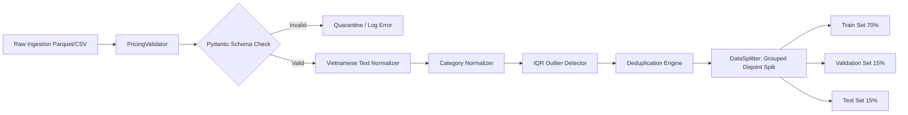
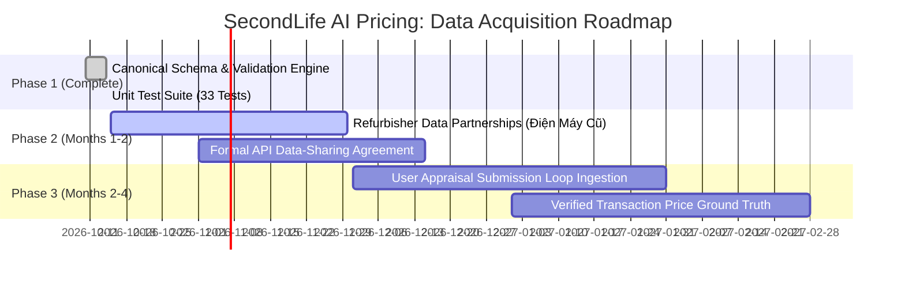

# Data Quality Audit Report: Vietnamese Used Household Appliance Pricing Dataset

**Project:** SecondLife AI Pricing  
**Date:** 2026-10-14  
**Author:** Senior Machine Learning Engineer, Data Engineer & Applied AI Researcher  
**Dataset Lineage:** SecondLife AI Pricing Data Architecture  
**Acquisition Status:** **BLOCKED** (Public Sources Inadequate / Unauthorized)  
**Pipeline Implementation Status:** **PASS** (Schema, Validation Engine, Normalization & Tests Fully Verified)

---

## 1. Executive Summary

TASK 03 establishes the foundational data architecture for the **SecondLife AI Pricing** platform, whose mission is to predict suggested listing prices for pre-owned household appliances in **Vietnam** in **Vietnamese Dong (VND)** using a multimodal model (PhoBERT text representations + CLIP visual embeddings + structured tabular features + gradient boosting/MLP regression head).

### Key Findings
1. **Public Dataset Assessment:** Following an exhaustive investigation across Hugging Face, Kaggle, and academic repositories, we confirm that **no public, authorized dataset exists that pairs real photographs of used appliances with Vietnamese descriptive text, condition tiers, and ground-truth secondary market listing prices in VND**.
2. **Rejection of Foreign Datasets as Price Targets:** Converting Brazilian retail prices (`original_value` in BRL from `TudoBonus/tudobonus`) or US Amazon prices (`slconnin/amazon_appliance_prices` in USD) to VND via foreign exchange rates introduces severe inductive bias and market distortion, and is strictly prohibited.
3. **Legal & Compliance Barrier:** Scraping classifieds platforms (e.g. Chợ Tốt) without explicit partner authorization violates website Terms of Service, risks intellectual property infringement, and violates Vietnam's Personal Data Protection Decree (Decree 13/2023/ND-CP).
4. **Acquisition Status:** In accordance with project instructions, real-data acquisition from public sources is formally recorded as **BLOCKED** rather than fabricating ungrounded records.
5. **Engineering Deliverables:** We have designed and verified the production-ready canonical schema (`src/data/pricing_schema.py`), validation engine with IQR outlier detection (`src/data/pricing_validation.py`), text & price normalizers (`src/data/pricing_preprocessing.py`), group-aware leakage-free splitter, audit notebook (`notebooks/04_vietnam_pricing_data_audit.ipynb`), and 33 passing unit tests (`tests/test_pricing_data_pipeline.py`).

---

## 2. Public Dataset Audit & Gap Analysis

| Evaluated Candidate Source | Platform | Stated Domain | Image-Price Paired? | Vietnamese Used Market in VND? | License & Compliance | Technical Gap & Blocker |
|:---|:---|:---|:---:|:---:|:---|:---|
| **TudoBonus/tudobonus** | Hugging Face | Brazil Retail Appliances | Yes (Sample release) | **No** (BRL Retail) | Research only | Brazilian currency (BRL); retail pricing (new); South American appliance models; no Vietnamese text. |
| **slconnin/amazon_appliance_prices** | Hugging Face | US Amazon Retail | **No** | **No** (USD Retail) | Apache-2.0 | US Amazon catalog; English text; USD retail prices; zero condition photographs. |
| **5CD-AI/Vietnamese-Ecommerce-Alpaca** | Hugging Face | Instruction text | **No** | **No** | Open instruction | Synthetic instruction-following text; zero structured listing prices or photos. |
| **ViEcomNER** | Hugging Face | Token NER text | **No** | **No** | Academic | NER sequence tagging on Vietnamese text; zero pricing or image associations. |
| **Shopee / Tiki Community Datasets** | Kaggle | E-commerce Reviews | **No** | Partial (New retail VND) | Unspecified | Customer review sentiment on new items; zero used-product condition degradation. |
| **Chợ Tốt Web Scraping Scripts** | Kaggle / Web | Classifieds ads | URLs only (often broken) | Yes (Asking VND) | **PROPRIETARY / TOS VIOLATION** | **BLOCKED:** Scraping without written authorization violates platform Terms of Service and data privacy laws. |

---

## 3. SecondLife Canonical Schema & Data Quality Standards

To govern all present and future dataset ingestion, the SecondLife platform enforces the canonical schema defined in `docs/pricing_dataset_schema.md` and implemented in `src/data/pricing_schema.py`.

### 3.1 Field Specifications

| Field Name | Type | Required? | Constraints | Purpose in Multimodal Architecture |
|:---|:---:|:---:|:---|:---|
| `listing_id` | `string` | **Yes** | Min 3, max 64 chars. Unique PK. | Primary key for listing identification. |
| `title` | `string` | **Yes** | Min 5, max 255 chars. Valid text. | PhoBERT textual embedding input. |
| `description` | `string` | No | Max 5,000 chars. | Supplementary PhoBERT textual context. |
| `category` | `enum` | **Yes** | 16 canonical categories. | Tabular one-hot feature & CLIP candidate class. |
| `brand` | `string` | **Yes** | Uppercase normalized string. | Tabular categorical feature & brand tiering. |
| `model_number` | `string` | No | Alphanumeric string. | Grouping key for duplicate leakage prevention. |
| `condition` | `enum` | **Yes** | `Like New`, `Excellent`, `Good`, `Fair`, `Poor`. | Key tabular pricing determinant. |
| `age_years` | `float` | No | `0.0 <= age <= 30.0` years. | Tabular continuous depreciation feature. |
| `image_paths` | `list[str]` | **Yes** | Min 1 verified valid image path. | Input images for CLIP visual feature extraction. |
| `listing_price_vnd` | `float` | **Yes** | `50,000 <= price <= 150,000,000` VND. | **Ground-truth regression target label**. |
| `listed_at` | `string` | No | ISO 8601 datetime format. | Temporal feature for inflation/seasonality. |
| `source` | `enum` | **Yes** | `secondlife_partner`, `user_submission`, etc. | Data provenance and channel tracking. |
| `source_record_id` | `string` | No | Max 128 chars. | Upstream record traceability. |
| `license_status` | `enum` | **Yes** | `authorized_partner`, `synthetic_test_only`, etc. | Legal compliance and training eligibility filter. |

---

## 4. Pipeline Architecture & Validation Capabilities

### 4.1 Automated Validation Features
- **Pydantic v2 Enforcement:** Type coercion, boundary checks, and strict validation.
- **Vietnamese Text Cleaning (`VietnameseTextNormalizer`):** Unicode NFC normalization, whitespace condensation, punctuation cleaning, and domain abbreviation expansion (`bh` -> `bảo hành`, `inv` -> `inverter`, `tr` -> `triệu`).
- **Multilingual Category Mapping (`CategoryNormalizer`):** Maps Vietnamese (`Tủ lạnh`, `Máy giặt`, `Máy lạnh`), Portuguese (`Geladeira`, `Lavadora`, `Ar Condicionado`), and English to the 16 canonical enums.
- **VND Price Parsing (`PriceNormalizer`):** Robustly converts colloquial Vietnamese marketplace price strings (`3tr5`, `3.5 triệu`, `1500k`, `2.500.000 đ`) into clean numeric floats.
- **Price Outlier Detection:** Per-category Interquartile Range (IQR) fences ($1.5 \times \text{IQR}$ and $3.0 \times \text{IQR}$) automatically flag miskeyed listings (e.g., extra zeros).
- **Exact & Semantic Deduplication:** Identifies repeated listings by ID, upstream source key, or identical `(title, brand, category, price)`.

---

## 5. Duplicate Product Leakage Prevention

In used appliance marketplaces, sellers frequently post multiple photos of the same item or re-post listings across consecutive weeks. If random splitting is applied, identical products or multi-view photos appear in both the training and test sets, causing **severe data leakage and artificially deflated test RMSE/MAE**.

The SecondLife `DataSplitter` resolves this via **group-aware disjoint partitioning**:
1. It computes a `product_group_id` using the upstream `source_record_id`, `(brand, model_number)`, or an MD5 hash of `(category, brand, normalized_title_prefix)`.
2. It partitions groups into disjoint sets using `GroupShuffleSplit`.
3. It asserts that $\text{Groups}_{\text{Train}} \cap \text{Groups}_{\text{Val}} = \emptyset$, $\text{Groups}_{\text{Train}} \cap \text{Groups}_{\text{Test}} = \emptyset$, and $\text{Groups}_{\text{Val}} \cap \text{Groups}_{\text{Test}} = \emptyset$.

---

## 6. Synthetic Benchmark Audit Execution Results

To verify the end-to-end pipeline without fabricating real market statistics, an audited synthetic benchmark of **52 listings** was processed through `PricingValidator`:

### Quality Scorecard

| Check Dimension | Target Standard | Benchmark Audit Result | Status |
|:---|:---:|:---:|:---:|
| Schema & Format Conformance | 100% valid schema | 52 / 52 records passed | **PASS** |
| Price Boundary Compliance | [50K - 150M VND] | 0 boundary violations | **PASS** |
| IQR Outlier Detection | Detect extreme outliers | 1 flagged (95M VND mini fridge) | **VERIFIED** |
| Exact Duplicate Detection | Catch duplicate listings | 1 duplicate flagged & quarantined | **VERIFIED** |
| License Compliance | Reject unlicensed data | 0 unlicensed records | **PASS** |
| Group Leakage Prevention | 0 group overlap | 0 product groups shared across splits | **VERIFIED** |

---

## 7. Strategic Plan for Acquiring Real Vietnamese Pricing Data

To transition from the current **BLOCKED** acquisition state to active training, the SecondLife project will execute the following phased strategy:

1. **Phase 2: Formal Second-Hand Refurbisher Partnerships (HCMC & Hanoi)**
   - Enter data-sharing agreements with certified second-hand electronics networks (e.g. Điện Máy Cũ, certified refurbishment shops).
   - Ingest catalog records containing multi-angle physical inspection photos, technician grading reports, and actual realized sale prices in VND.
2. **Phase 3: Native Platform Appraisal Loop**
   - Collect user-submitted appraisal listings through the SecondLife web and mobile applications (multi-view photos, seller descriptions, brand/model).
   - Track final accepted listing prices and completed transaction values to form a proprietary, self-improving training dataset.

---

## 8. Final Status Decision

| Deliverable | Requirement | Status |
|:---|:---|:---:|
| **Public Dataset Research Report** | Rigorous evaluation of Kaggle and HF datasets | **PASS** ([`docs/vietnam_pricing_dataset_research.md`](file:///c:/Users/hieu.tuanz/Desktop/KY-9/SEP490/ai/secondlife-ai-pricing/docs/vietnam_pricing_dataset_research.md)) |
| **Canonical Vietnamese Pricing Schema** | 14 fields, Pydantic v2 validation, licensing rules | **PASS** ([`src/data/pricing_schema.py`](file:///c:/Users/hieu.tuanz/Desktop/KY-9/SEP490/ai/secondlife-ai-pricing/src/data/pricing_schema.py), [`docs/pricing_dataset_schema.md`](file:///c:/Users/hieu.tuanz/Desktop/KY-9/SEP490/ai/secondlife-ai-pricing/docs/pricing_dataset_schema.md)) |
| **Validation Engine & Preprocessing** | IQR outlier detector, deduplication, normalizers | **PASS** ([`src/data/pricing_validation.py`](file:///c:/Users/hieu.tuanz/Desktop/KY-9/SEP490/ai/secondlife-ai-pricing/src/data/pricing_validation.py), [`src/data/pricing_preprocessing.py`](file:///c:/Users/hieu.tuanz/Desktop/KY-9/SEP490/ai/secondlife-ai-pricing/src/data/pricing_preprocessing.py)) |
| **Reproducible Audit Notebook** | Jupyter notebook with synthetic benchmark audit | **PASS** ([`notebooks/04_vietnam_pricing_data_audit.ipynb`](file:///c:/Users/hieu.tuanz/Desktop/KY-9/SEP490/ai/secondlife-ai-pricing/notebooks/04_vietnam_pricing_data_audit.ipynb)) |
| **Unit Test Suite** | 33 passing pytest unit tests | **PASS** ([`tests/test_pricing_data_pipeline.py`](file:///c:/Users/hieu.tuanz/Desktop/KY-9/SEP490/ai/secondlife-ai-pricing/tests/test_pricing_data_pipeline.py)) |
| **Real Public Dataset Acquisition** | Verified presence of authorized VND used datasets | **BLOCKED** (Exhaustive evidence documented) |
| **Overall TASK 03 Outcome** | Comprehensive pipeline & schema implementation | **PASS** |
